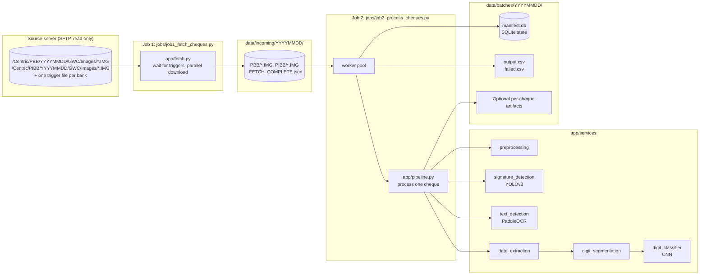
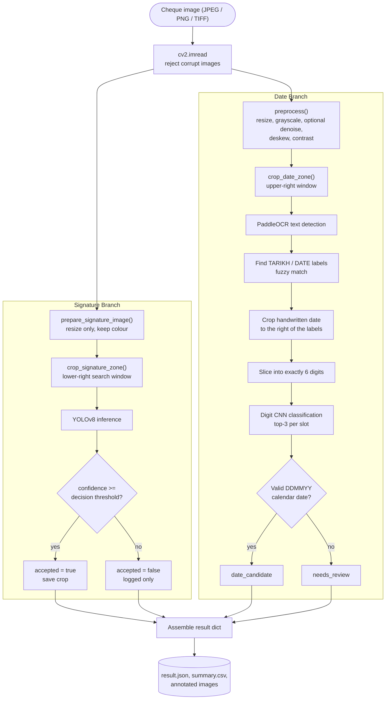
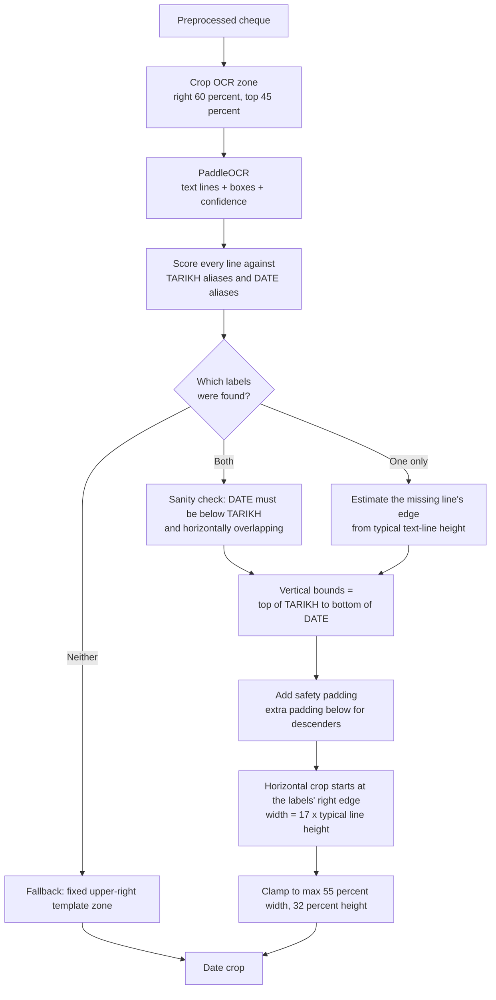
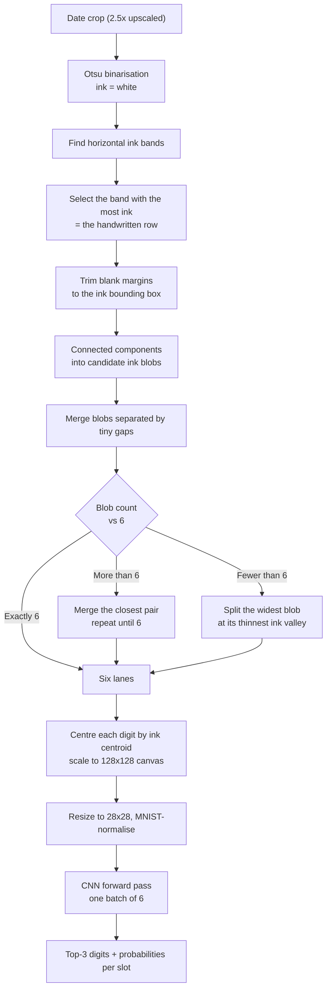
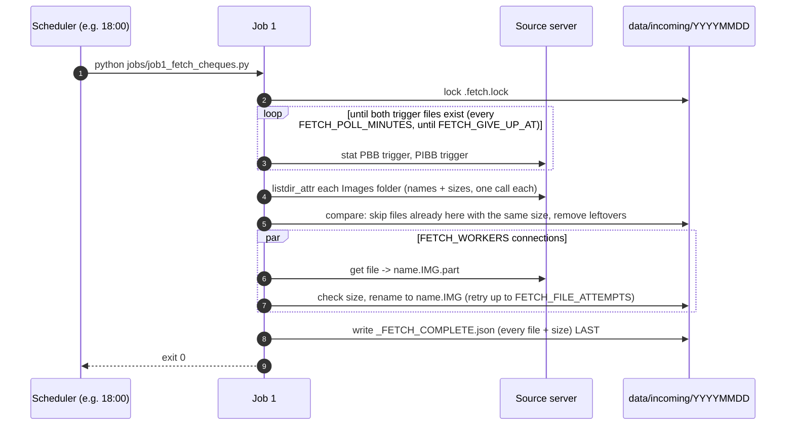
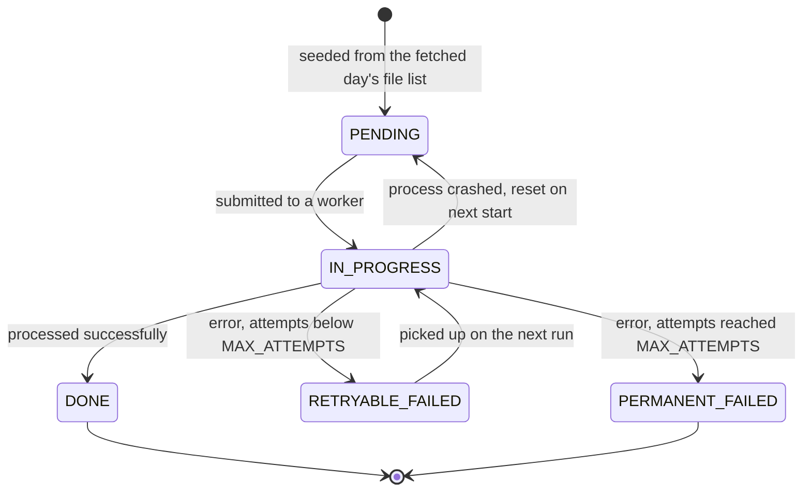
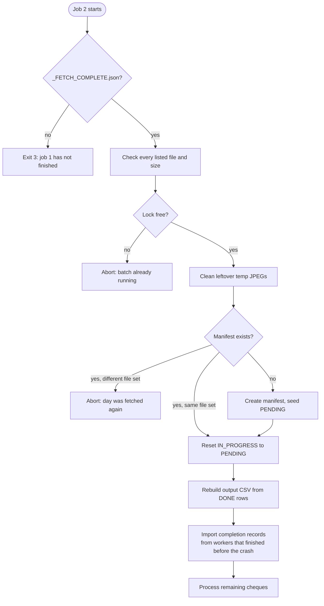

# Cheque Processing Platform

An auditable, crash-resilient cheque analysis pipeline built with **YOLOv8**, **PaddleOCR**, and a **digit-recognition CNN**. For every cheque image the system answers two questions: *is there a signature?* and *what handwritten date is written on it?* It runs as **two daily batch jobs**: job 1 fetches the day's `.IMG` files from the source server over SFTP, and job 2 processes them (~20,000 cheques a day), backed by a SQLite manifest so that no cheque is ever lost or processed twice, even after a crash.

---

## 📑 Table of Contents

- [Overview & Architecture](#-overview--architecture)
- [Key Features](#-key-features)
- [Extracted Entities](#-extracted-entities)
- [How a Single Cheque Is Processed](#-how-a-single-cheque-is-processed)
- [The Daily Batch: Two Jobs](#-the-daily-batch-two-jobs)
- [System Requirements](#-system-requirements)
- [Installation & Setup](#-installation--setup)
- [Configuration (.env)](#-configuration-env)
- [Running the Jobs](#-running-the-jobs)
- [Output Reference](#-output-reference)
- [Directory Structure & Storage Layout](#-directory-structure--storage-layout)
- [Performance & Worker Tuning](#-performance--worker-tuning)
- [Failure Handling & Resiliency](#-failure-handling--resiliency)
- [Security Notes](#-security-notes)
- [Known Limitations](#-known-limitations)
- [Troubleshooting](#-troubleshooting)

---

## 🏗 Overview & Architecture

Job 1 copies the day's images from the source server; job 2 runs every cheque through **one processing core** (`app/pipeline.py`). The jobs are separate programs: a network problem never kills a half-done processing run, and either one can be rerun on its own. Job 2 only starts once job 1 has written `_FETCH_COMPLETE.json`.



---

## ✨ Key Features

- **Two-signal analysis per cheque**: YOLOv8 signature detection and OCR-anchored handwritten-date reading, each independently reported with confidence scores.
- **Layout-anchored date reading**: instead of trusting a fixed pixel position, the system uses PaddleOCR to find the printed **TARIKH / DATE** labels and crops the handwritten date relative to them. This makes it robust to different scan sizes and small template shifts.
- **Fuzzy label matching**: tolerates common OCR misreads (`TARlKH`, `D4TE`, `DATF`, …) and can reconstruct the crop from a single found label when the other is unreadable.
- **Ink-driven digit segmentation**: connected-component clustering splits the date row into exactly six digits, merging broken strokes and splitting touching digits at their thinnest ink point.
- **Calendar validation**: the six digits (`DDMMYY`) are checked against the real calendar (including leap years) and flagged `date_candidate` or `needs_review`.
- **Resumable batch processing**: a SQLite manifest tracks every cheque's state. Kill the process at any moment and a re-run resumes exactly where it stopped.
- **Durable, exactly-once output**: a per-cheque completion record is written and fsynced *before* the parent acknowledges it, and the output CSV is rebuilt on startup to repair any half-written row.
- **Efficient, safe fetching**: one listing call per bank folder, parallel SFTP downloads, `.part` files renamed only after a size check, reruns copy only what is missing, and the source server is never modified.
- **Auto-sized worker pool**: worker count derived from CPU cores, with native thread pools (OpenMP / MKL / BLAS) capped per worker to prevent oversubscription.
- **Retention**: fetched images are deleted after `INCOMING_RETENTION_DAYS` (default 30), batch output after `BATCH_RETENTION_DAYS` (default: kept); only finished days are ever deleted.
- **Full audit trail**: annotated images, crops, per-digit top-3 candidates, and a complete `result.json` for every cheque (optional, toggled by `SAVE_ARTIFACTS`).

---

## 🎯 Extracted Entities

| Field | Description |
| :--- | :--- |
| `signature` | `YES` / `NO`. Whether at least one YOLO detection met the decision threshold. |
| Signature detections | Bounding boxes (`x1, y1, x2, y2`) and confidence for up to 2 candidates (`result.json`). |
| `date` | `DD/MM/YYYY` when valid; what was read when invalid (e.g. `18/21/71`); `NO DATE` when nothing is written. |
| `date_status` (output CSV) | `VALID`, `INVALID` or `NO DATE`. |
| `flagged`, `flag_reason` | `YES` when a person should check the cheque, and why: `NO SIGNATURE`, `NO DATE`, `INVALID DATE`. |
| `status` (`result.json`) | `date_candidate` (valid calendar date), `needs_review` (best guess, invalid or uncertain), or `empty_crop`. |
| `raw_digits` | The six classified digits with no separators, e.g. `160926`. |
| `date_confidence` | The **weakest** per-digit probability (a date is only as trustworthy as its least certain digit). |
| Per-digit top-3 | For each of the 6 slots, the three most likely digits with probabilities. |
| OCR text lines | All printed text found in the date region with quadrilateral coordinates and confidence. |
| `bank_code` | `PBB` or `PIBB`, the source folder the cheque came from. |

> **Signature detection is presence detection only.** The system reports *whether a signature-like region exists*, not whether it is *authentic* or matches a specimen.

> **Review-assisted by design.** Handwriting varies. Treat `needs_review` results as prompts for a human check, and use the confidence values to prioritise that review.

---

## 🔬 How a Single Cheque Is Processed

`process()` in `app/pipeline.py` runs these stages. The signature branch and the date branch are independent of each other (they share only the input image).



### Stage 1: Preprocessing (`app/services/preprocessing.py`)

The pipeline deliberately produces **two different copies** of the image, because signature detection and OCR want opposite things:

| Copy | Steps | Why |
| :--- | :--- | :--- |
| **OCR copy** (`preprocess`) | Upscale small scans (short edge below 1000 px, up to 4×) → cap the long edge (`PREPROCESS_MAX_LONG_EDGE`, default 3000) → grayscale → optional denoise → deskew (only if the angle is within ±8°, otherwise ignored as unreliable) → contrast boost | Clean, high-contrast text is easier for OCR and digit slicing. |
| **Signature copy** (`prepare_signature_image`) | Resize only, **colour preserved**, long edge capped at `SIGNATURE_MAX_LONG_EDGE` (1600) | Denoise / contrast / deskew can erase light pen strokes, so YOLO gets an untouched colour copy. |

The original image is never modified.

### Stage 2: Signature detection (`app/services/signature_detection.py`)

1. The resized colour image is cropped to a **search zone** (default: right 70% of the width, from 55% to 92% of the height), where signatures reliably sit on this cheque template. A smaller search area means real signature ink occupies far more of the model's input pixels and is not drowned out by security-pattern background.
2. **YOLOv8** runs on the crop (`SIGNATURE_IMGSZ`, default 640; NMS IoU 0.70; at most 2 detections).
3. Every candidate above a very low *logging floor* (1%) is recorded so you can inspect near-misses, but only candidates at or above the **decision threshold** (default `0.30`) are marked `accepted`.
4. Box coordinates are translated back into the full-image frame using the crop offset, so annotations always land correctly on the full cheque.
5. The cheque counts as `signature = YES` if **any** candidate is accepted.

The model is loaded once per process behind a lock. If the weights file is missing, the code can optionally download it from Hugging Face (`HF_YOLO_REPO_ID` + `HF_YOLO_FILENAME`).

### Stage 3: Locating the date field (`app/services/text_detection.py`, `date_extraction.py`)

Cheque dates are handwritten, but the **printed labels beside them** are stable. On a Public Bank cheque, `TARIKH` sits directly above `DATE`. The system finds those labels first, then reads what is to their right.



Key ideas worth knowing:

- **Fuzzy matching.** Each OCR line is normalised (uppercase, alphanumerics only) and scored against alias lists using substring match plus `difflib` similarity (threshold 0.66). Aliases include known OCR corruptions such as `TARlKH`, `D4TE`, `DATF`. A weak `WN` token is accepted as a possible label only in the upper-right region.
- **Scale-invariant sizing.** Crop padding and width are expressed in multiples of the **median text-line height** found on the page, not in pixels, so the geometry holds when scan resolution changes.
- **Asymmetric padding.** Extra room is added *below* the labels because looped digits (a `6` or `2`) and descenders extend lower than printed text predicts.
- **Hard ceilings.** Crop size is capped as a fraction of the page as a last line of defence against a bad anchor measurement.

### Stage 4: Reading the digits (`digit_segmentation.py`, `digit_classifier.py`)

The date crop is upscaled 2.5×, then converted into exactly six normalised digit images.



Why this design:

- **Band selection by ink area** (not height) rejects the small printed `D D M M Y Y` guide letters and stray text above the date.
- **Cluster to exactly six** handles the two classic handwriting failure modes: a digit drawn in two strokes (merge) and two digits that touch, such as a connected `26` (split at the valley).
- **Centroid centring** narrows the domain gap between real cheque ink and the MNIST-style data the classifier was trained on.
- **One batched forward pass** for all six digits is much cheaper than six separate calls.

The classifier backend is swappable via `DIGIT_MODEL_BACKEND`:

| Backend | Model | Notes |
| :--- | :--- | :--- |
| `torch_pickle` *(default)* | Small CNN (`DigitCNN`, from `developerPratik/mnist-cnn-classifier`) | Built for 28×28 digits, fast on CPU. |
| `transformers` | ViT-based MNIST model | ~17.5 GFLOPs per digit (≈105 GFLOPs per cheque), so it dominated the date stage; kept as an option only. |

### Stage 5: Validation and result

The six winning digits are formatted as `DD/MM/YY` and validated as a real calendar date (`2000 + YY`, leap-year aware). Overall `confidence` is the **minimum** per-digit probability. The final dictionary is written atomically to `result.json` (temp file + `os.replace`).

---

## 📦 The Daily Batch: Two Jobs

### Source layout (read only)

```text
<SOURCE_ROOT>/PBB/YYYYMMDD/GWC/Images/*.IMG      e.g. 202610130233041011018120290009.IMG
<SOURCE_ROOT>/PIBB/YYYYMMDD/GWC/Images/*.IMG
<SOURCE_TRIGGER_PATTERN>                          one per bank: marks that bank's day as complete
```

The folder layout and trigger path are settings (`SOURCE_IMAGES_PATTERN`, `SOURCE_TRIGGER_PATTERN`), with `{root}`, `{bank}` and `{date}` placeholders. The extension is matched in any case (`.IMG` / `.img`). Nothing on the source is ever deleted, moved or written; the trigger files are only read.

### Job 1: fetch (`jobs/job1_fetch_cheques.py`)



- One folder per day: `data/incoming/YYYYMMDD/PBB/*.IMG` and `.../PIBB/*.IMG`. No ZIP: SFTP cannot zip on the source side, and zipping after download would only add time and a second copy.
- The cheque ID is `<bank>/<file name>`, so the same file name in PBB and PIBB never clashes.
- A rerun copies only what is still missing. Once `_FETCH_COMPLETE.json` exists, the day is not fetched again unless `--force` is given.
- A bank whose trigger exists but whose `Images` folder does not is counted as 0 cheques (logged as a warning).

| Exit code | Meaning |
| :--- | :--- |
| `0` | The day is fetched (or was already). |
| `1` | Not ready (trigger missing at `FETCH_GIVE_UP_AT`), some files not copied, or the server could not be reached. Run again later. |
| `2` | Configuration problem (missing `.env` setting, server not in `known_hosts`, login refused). Fix it first. |

### Job 2: process (`jobs/job2_process_cheques.py`)

```mermaid
sequenceDiagram
    autonumber
    participant S as Scheduler
    participant R as Job 2 (parent)
    participant M as manifest.db (SQLite)
    participant W as Worker process
    participant FS as Disk

    S->>R: python jobs/job2_process_cheques.py
    R->>FS: read _FETCH_COMPLETE.json; check every listed file exists with its size
    R->>FS: acquire batch lock (.lock)
    R->>M: seed all cheques as PENDING (idempotent; file-set fingerprint checked)
    R->>M: reset IN_PROGRESS back to PENDING
    R->>FS: rebuild output CSV from DONE rows (repair)
    R->>FS: import leftover completion records

    loop each pending cheque (bounded in-flight queue)
        R->>M: mark IN_PROGRESS
        R->>W: submit task
        W->>FS: read .IMG, convert to temp JPEG
        W->>W: pipeline.process()
        W->>FS: write completion JSON (atomic + fsync)
        W-->>R: ok
        R->>M: mark DONE
        R->>FS: append CSV row (fsync)
    end

    R->>FS: write failed CSV; _BATCH_COMPLETE.json when nothing is left to retry
    R->>FS: retention cleanup of old finished days
    R-->>S: exit code 0, 1, 2 or 3
```

Each `.IMG` is decoded with Pillow, **frame zero** is used (multi-frame TIFF-style images), converted to RGB if needed, and re-encoded as a temporary JPEG (quality 95) that is deleted right after processing.

### Cheque lifecycle

Every cheque is a row in the manifest's `cheques` table and moves through this state machine:



> Each run attempts every unfinished cheque **once**. A cheque that fails becomes `RETRYABLE_FAILED` and is retried the **next time job 2 runs**, up to `MAX_ATTEMPTS` total attempts (default 3). Use the exit code to trigger a rerun.

### Why it never loses or duplicates a cheque

| Concern | Mechanism |
| :--- | :--- |
| Half-copied file | Job 1 downloads to `*.part`, checks the size against the source listing, then renames |
| Half-fetched day | `_FETCH_COMPLETE.json` is written last; job 2 refuses to start without it and checks every listed file and size |
| Source safety | The source server is **only read**; triggers are never deleted |
| Day fetched again after processing began | The manifest stores a **fingerprint of the file list** (names + sizes); a different set is refused |
| Two runners at once | Exclusive file locks: `.fetch.lock` (job 1), `.lock` per batch (job 2) |
| Crash mid-cheque | `IN_PROGRESS` rows are reset to `PENDING` on next start and reprocessed |
| Crash between "worker finished" and "parent recorded it" | The worker writes an fsynced **completion JSON** first; on restart the runner imports any leftover completion records |
| Ambiguous last CSV row after a crash | The output CSV is **rebuilt atomically** from `DONE` rows on every start, before new rows are appended |
| Duplicate CSV rows | An `output_emitted` flag per cheque makes appends idempotent |
| One bad scan killing the batch | Each worker catches its own exceptions; failure is recorded and the batch continues |
| Memory blow-up on 20,000 cheques | Only `workers × BATCH_INFLIGHT_MULTIPLIER` tasks are ever queued at once |

### Exit codes (job 2)

| Code | Meaning |
| :--- | :--- |
| `0` | Every cheque is `DONE`. |
| `1` | Some cheques are still unfinished (`PENDING` / `RETRYABLE_FAILED`). Run again to continue. |
| `2` | Everything was attempted, but some cheques are `PERMANENT_FAILED`. See `<date>_failed.csv`. |
| `3` | Job 1 has not finished the day (no `_FETCH_COMPLETE.json`). |

### Which day

Both jobs take `--date YYYYMMDD` for reruns and catch-up. Without it they use today minus `DATE_OFFSET_DAYS` (default `0`). This is a placeholder until the batch date is confirmed; only `app/batch_date.py` needs to change then.

### Retention

At the end of job 2, folders named `YYYYMMDD` are deleted:

- `data/incoming/<date>/` (the fetched images) once older than `INCOMING_RETENTION_DAYS` (default **30**),
- `data/batches/<date>/` (output CSV, manifest, any artifacts) once older than `BATCH_RETENTION_DAYS` (default **0 = keep forever**),

and only when that day's batch **finished** (`_BATCH_COMPLETE.json`). An unfinished day past its retention is kept and logged as a warning.

---

## ⚙️ System Requirements

- **Operating System**: Linux (SVDWH008) or Windows. Batch locking uses `fcntl` on Linux and `msvcrt` on Windows.
- **Python**: 3.10 or 3.11 (PaddleOCR support is substantially better than on 3.9).
- **Hardware**: CPU-only inference. No GPU is required or used.
- **Network**: job 1 needs to reach the source server's SFTP port (22 by default). Check from the server first: `nc -vz <server-ip> 22`.
- **Disk**: ~20,000 files × 20–60 KB is about 0.4–1.2 GB of images a day, so about 12–36 GB with the default 30 days kept. With `SAVE_ARTIFACTS=true`, each cheque also writes roughly 20 debug files.
- **Model files** (not included in the repository):
  - YOLOv8 signature weights, `models/yolov8s.pt`
  - Digit CNN weights, `models/developerPratik-mnist-cnn/best_model.pth`
  - PaddleOCR models (detection, recognition, optional angle classifier) in a shared folder

---

## 🚀 Installation & Setup

### 1. Clone the Repository
```powershell
git clone https://github.com/heyitssyakirrr/cheque-processing-platform.git
cd cheque-processing-platform
```

### 2. Create and Activate a Virtual Environment
```powershell
py -3.11 -m venv .venv
.\.venv\Scripts\Activate.ps1
```

### 3. Install Dependencies
```powershell
python -m pip install --upgrade pip
pip install -r requirements.txt
```

Key pinned versions: `paddlepaddle==2.6.2`, `paddleocr==2.10.0`, `numpy<2`.

### 4. Place the Model Files

```text
cheque-processing-platform/
└── models/
    ├── yolov8s.pt                          # signature detector (YOLO_MODEL_PATH)
    └── developerPratik-mnist-cnn/
        └── best_model.pth                  # digit classifier (DIGIT_MODEL_PATH)

../FileReader/models/                       # shared PaddleOCR models (OCR_MODELS_DIR)
├── en_PP-OCRv3_det_infer/
├── en_PP-OCRv3_rec_infer/
└── ch_ppocr_mobile_v2.0_cls_infer/         # optional angle classifier
```

- The PaddleOCR models are read from a **shared folder** (default `../FileReader/models`) so several projects can use one copy instead of duplicating them. Point `OCR_MODELS_DIR` elsewhere if your layout differs.
- If the YOLO file is missing you may instead set `HF_YOLO_REPO_ID` and `HF_YOLO_FILENAME`; the weights are downloaded once and cached under `models/`.
- On an **offline** machine, make sure all three model sets are already on disk; PaddleOCR will otherwise try (and fail) to download.

### 5. Create the `.env`
Copy `.env.example` to `.env` and fill in the SFTP server details (see the next section). `.env` is git-ignored, so passwords never reach the repository.

### 6. Trust the source server's host key (once)
Job 1 refuses any server whose key is not in `known_hosts`, so it can never be pointed at an impostor. Get the key's fingerprint from the server's team, then on the machine that runs job 1:

```bash
ssh-keyscan -p 22 <server> >> ~/.ssh/known_hosts
ssh-keygen -lf ~/.ssh/known_hosts      # compare the fingerprint with the one you were given
```

---

## 🔧 Configuration (.env)

Settings are defined in one validated object (`app/settings.py`, Pydantic Settings). Every field can be overridden by an environment variable of the **same name (case-insensitive)** or by a line in `.env` at the project root.

### Minimal example

See `.env.example` for every setting the jobs need. The essentials:

```ini
SFTP_HOST=<server name or IP>
SFTP_USERNAME=<user>
SFTP_PASSWORD=<password>            # or SFTP_KEY_PATH=/home/<you>/.ssh/id_rsa
SOURCE_ROOT=/Centric
SOURCE_TRIGGER_PATTERN={root}/{bank}/{date}/GWC/<trigger name>
WORKER_COUNT=1
```

### Signature detection

| Variable | Default | Description |
| :--- | :--- | :--- |
| `YOLO_MODEL_PATH` | `models/yolov8s.pt` | Weights path, relative to project root. |
| `HF_YOLO_REPO_ID` / `HF_YOLO_FILENAME` | *(empty)* | Optional Hugging Face source used only if the local file is missing. |
| `SIGNATURE_IMGSZ` | `640` | YOLO inference resolution. Source scans are small (~700×350), so higher values add compute without adding information. |
| `SIGNATURE_IOU` | `0.70` | NMS overlap threshold between candidate boxes. |
| `SIGNATURE_DECISION_THRESHOLD` | `0.30` | Confidence at or above which a box counts as "signature present". |
| `SIGNATURE_LOGGING_FLOOR` | `0.01` | Lowest confidence still recorded for inspection. |
| `SIGNATURE_MAX_LONG_EDGE` | `1600` | Resize ceiling for the signature copy of the image. |
| `SIGNATURE_ZONE_LEFT_FRACTION` | `0.30` | Left edge of the search window (fraction of width). |
| `SIGNATURE_ZONE_TOP_FRACTION` | `0.55` | Top edge of the search window (fraction of height). |
| `SIGNATURE_ZONE_BOTTOM_FRACTION` | `0.92` | Bottom edge of the search window (fraction of height). |

### Date field location (OCR)

| Variable | Default | Description |
| :--- | :--- | :--- |
| `OCR_MODELS_DIR` | `../FileReader/models` | Folder holding the PaddleOCR model sub-folders. |
| `OCR_ZONE_LEFT_FRACTION` | `0.40` | Left edge of the region OCR scans for labels. |
| `OCR_ZONE_TOP_FRACTION` / `OCR_ZONE_BOTTOM_FRACTION` | `0.00` / `0.45` | Vertical extent of the OCR region. |
| `DATE_LABEL_LINE_GAP_RATIO` | `0.2` | Gap used when estimating a missing label line. |
| `DATE_FIELD_VERTICAL_SAFETY_PAD_RATIO` | `0.15` | Padding above and below the label span. |
| `DATE_FIELD_BOTTOM_EXTRA_PAD_RATIO` | `0.35` | Extra padding below, for descenders and loops. |
| `DATE_FIELD_WIDTH_TYPICAL_HEIGHTS` | `17.0` | Crop width in multiples of typical line height. |
| `DATE_FIELD_MAX_WIDTH_FRACTION` / `DATE_FIELD_MAX_HEIGHT_FRACTION` | `0.55` / `0.32` | Hard ceiling on crop size. |
| `DATE_USE_TEMPLATE_ZONE` | `false` | Debug only: skip OCR and use the fixed template zone. Keep **off** in production. |

### Digit classifier

| Variable | Default | Description |
| :--- | :--- | :--- |
| `DIGIT_MODEL_BACKEND` | `torch_pickle` | `torch_pickle` (small CNN) or `transformers` (ViT). |
| `DIGIT_MODEL_PATH` | `models/developerPratik-mnist-cnn/best_model.pth` | Weights matching the chosen backend. Change both together. |
| `DIGIT_COUNT` | `6` | Expected digits per date (`DDMMYY`). |
| `DIGIT_INK_THRESHOLD` | `140` | Fixed grayscale cut-off for "ink". |

### Preprocessing

| Variable | Default | Description |
| :--- | :--- | :--- |
| `PREPROCESS_MAX_LONG_EDGE` | `3000` | Long-edge cap for the OCR copy. |
| `PREPROCESS_CONTRAST` | `1.15` | Contrast multiplier. |
| `PREPROCESS_DESKEW` | `true` | Correct small tilt (up to 8°). |
| `PREPROCESS_DENOISE` | `false` | Non-local-means denoise. Costs about a second per cheque, so it is off by default. |

### Job 1: fetch from the source server

| Variable | Default | Description |
| :--- | :--- | :--- |
| `SOURCE_TRANSPORT` | `sftp` | `sftp`, or `local` when the source tree is a folder on this machine (a mounted share, or a fake tree for testing). |
| `SFTP_HOST` / `SFTP_PORT` | *(empty)* / `22` | Source server. |
| `SFTP_USERNAME` | *(empty)* | Login name. |
| `SFTP_PASSWORD` / `SFTP_KEY_PATH` | *(empty)* | Password, or a private key file. One of them is required. |
| `SFTP_KNOWN_HOSTS` | *(empty)* | Extra `known_hosts` file; `~/.ssh/known_hosts` is always read. Unknown servers are refused. |
| `SFTP_TIMEOUT_SECONDS` | `30` | Connect / login timeout. |
| `SOURCE_ROOT` | `/Centric` | Folder above `PBB/` and `PIBB/`. |
| `SOURCE_BANKS` | `PBB,PIBB` | Bank folders fetched each day. |
| `SOURCE_IMAGES_PATTERN` | `{root}/{bank}/{date}/GWC/Images` | Where one bank's `.IMG` files for one day are. |
| `SOURCE_TRIGGER_PATTERN` | *(empty)* | Full path of each bank's trigger file. Required (job 1 exits 2 without it), unless run by hand with `--skip-trigger`. |
| `FETCH_WORKERS` | `6` | Parallel SFTP connections. |
| `FETCH_FILE_ATTEMPTS` | `3` | Tries per file before job 1 gives up on it. |
| `FETCH_POLL_MINUTES` | `10` | How often to check again for missing trigger files. |
| `FETCH_GIVE_UP_AT` | `20:00` | Local time after which job 1 stops waiting and exits 1. |
| `INCOMING_ROOT` | `data/incoming` | Where fetched days are written. |

### Job 2: processing and retention

| Variable | Default | Description |
| :--- | :--- | :--- |
| `DATE_OFFSET_DAYS` | `0` | Without `--date`, both jobs use today minus this many days. |
| `MAX_ATTEMPTS` | `3` | Total attempts per cheque before it is permanently failed. |
| `BATCH_INFLIGHT_MULTIPLIER` | `2` | Queued futures per worker. |
| `SAVE_ARTIFACTS` | `false` | Write ~20 per-cheque debug files. Turn on only to investigate a batch. |
| `INCOMING_RETENTION_DAYS` | `30` | Days to keep fetched images (finished days only). `0` = forever. |
| `BATCH_RETENTION_DAYS` | `0` | Days to keep batch output (finished days only). `0` = forever; otherwise at least `INCOMING_RETENTION_DAYS`. |

### Worker sizing

| Variable | Default | Description |
| :--- | :--- | :--- |
| `WORKER_COUNT` | `0` | Fixed worker count. `0` means auto-size. |
| `WORKER_UTILIZATION_TARGET` | `0.40` | Fraction of usable cores to use when auto-sizing (0.05 to 1.0). |
| `RESERVED_LOGICAL_CORES` | `8` | Cores left free for the OS and other processes. |
| `MAX_WORKER_CAP` | `0` | Optional hard ceiling (`0` = none). |
| `THREADS_PER_WORKER` | `1` | Native threads per worker (OpenMP / MKL / BLAS / OpenCV / torch / Paddle). |

---

## 🏃 Running the Jobs

From the project folder:

```bash
python jobs/job1_fetch_cheques.py                  # fetch today's folder (waits for the trigger files)
python jobs/job2_process_cheques.py                # process it
```

Options (both jobs): `--date YYYYMMDD` to work on another day. Job 1 also has `--force` (fetch a day again) and `--skip-trigger` (by hand only: don't wait for the trigger files).

Example job 2 output:

```text
Batch 20261119: 20000 cheques {'PBB': 14000, 'PIBB': 6000}; 20000 to process; 12 worker(s).
[500/20000] PBB/202610130233041011018120290009.IMG -> DONE
...
Output: data/batches/20261119/20261119_output.csv
Status: {'DONE': 19997, 'PERMANENT_FAILED': 3} (5400s this run)
```

Each job also writes `data/logs/<date>_job1.log` / `<date>_job2.log`.

**To resume after a crash, power loss, or Ctrl+C: run the same command again.** Job 1 copies only what is missing; job 2 skips finished cheques, restarts interrupted ones, and repairs the CSV first.

### Scheduling

Schedule job 1 at the time the source is expected to be ready (for example 18:00); it waits for the trigger files until `FETCH_GIVE_UP_AT`. Start job 2 when job 1 exits `0` (same scheduler entry, or its own schedule: it exits `3` until the day is fetched). Rerun on exit code `1`; alert someone on job 1's `2` or job 2's `2`.

### Start with one worker

Begin with `WORKER_COUNT=1` and increase only after measuring memory and throughput on the target machine. With one worker the runner processes in-process (no process pool), which is also the easiest mode to debug.

### Checking tools (diagnostics/)

Run from the project folder against a batch already processed with `SAVE_ARTIFACTS=true`. No model is loaded.

| Script | What it does |
|---|---|
| `python diagnostics/check_date_crop.py --batch-id 20261113` | Re-crops every cheque's date box with the current settings and writes `data/batches/<id>/date crop check/`: one `<run>.png` per cheque (NEW crop, WHERE it sits on the cheque as a red box, and the OLD `date/crop.png`), `_all_new.png` with every new crop, and `_summary.csv`. |
| `python diagnostics/explore_date_area.py --batch-id 20261113` | Shows step by step how the date area is found: every OCR box near the date with its text, TARIKH/DATE, the printed D D M M Y Y letters found and the six boxes fitted to them, the crop used and the label-only crop, what the digit reader sees in each (its ink mask, row and digit splits) and what it reads. Writes `data/batches/<id>/date area explore/` with `_summary.csv` (measurements per cheque). `--only 009 012` limits it to some cheques; `--no-read` skips the digit model. |
| `python diagnostics/compare_ink_settings.py --batch-id 20261113` | Experiment for the digit reader's two ink settings (`DIGIT_INK_CEILING` for the strokes, `DIGIT_INK_MIN_CONTRAST` for deciding a date is blank): reads every cheque with every combination and, once you fill in the real dates (`--write-truth` creates `truth.csv`), scores them. Writes `data/batches/<id>/ink settings/` (readings, scores, and pictures of the strokes kept at each ceiling). |
| `python export_batch.py --batch-id 20261113` | Copies the output CSV (older layouts converted to the current columns) and every `original/cheque.png` to `data/batches/<id>/batch output/`; with an `answer_key.csv` in the batch folder also writes `<id>_scored.csv` (see Output Reference). `--write-answer-key` creates that file to fill in. |

### Processing a folder by hand (no SFTP)

To process images you already have (for example an old batch, or a test), put
them in `data/incoming/<date>/PBB/` and `data/incoming/<date>/PIBB/`, then:

```bash
python jobs/job2_process_cheques.py --date 20261113 --manual
python export_batch.py --batch-id 20261113
```

`--manual` lists the `.IMG` files in those folders and processes them without
waiting for job 1. A `data/batches/<date>/` folder left by the old ZIP version
is renamed to `<date>_old_format_<time>` (never deleted).

### Tests

```bash
python test/test_fetch.py
python test/test_ingestion_retention.py
```

They use a fake source tree in a temporary folder (no server, no models needed). The SFTP connection itself can only be tested against the real server.

### SVDWH008 copy (branch `uat-008`)

On SVDWH008 the project is `/pythonITD/dwh_312/Cheque_Processing`, next to `TransactionODD` and `FileReader`, and is imported as a package from `dwh_312`, so its imports read `from Cheque_Processing.app.settings import ...`. `main` keeps the plain `app.` imports. After committing on `main`, run:

```bash
python tools/build_uat_branch.py
```

It rebuilds `uat-008` from the last commit with the `Cheque_Processing.` prefix on every project import (and the jobs' `sys.path` line pointing at `dwh_312`, so `python Cheque_Processing/jobs/job1_fetch_cheques.py` works from there), checks that every prefixed import resolves, runs the tests on the prefixed copy, and force-pushes it. Copy files to SVDWH008 from `uat-008` as they are. Never edit `uat-008` by hand; `--no-push` builds, checks and tests without pushing.

---

## 📊 Output Reference

### Output CSV: `data/batches/<date>/<date>_output.csv`

One row per successfully processed cheque, appended live and fsynced.

| Column | Description |
| :--- | :--- |
| `batch_date` | The batch (`YYYYMMDD`). |
| `no` | 1-based order within the day's sorted file list. |
| `bank` | `PBB` or `PIBB`. |
| `file_name` | The `.IMG` file name. |
| `signature` | `YES` / `NO`. |
| `date` | `DD/MM/YYYY` when valid; what was read when invalid (e.g. `18/21/71`); `NO DATE` when the boxes are blank. |
| `date_status` | `VALID`, `INVALID` (read, but not a real date: scribble, stamp, misread) or `NO DATE` (nothing written). |
| `flagged` | `YES` when a person should check the cheque (no signature, or the date is not `VALID`), else `NO`. |
| `flag_reason` | Why it is flagged: `NO SIGNATURE`, `NO DATE`, `INVALID DATE`, joined with `; `. |
| `processed_on` | Date the cheque was processed (`YYYY-MM-DD`). |
| `start_time`, `end_time` | `HH:MM:SS`, on their own so Excel shows the seconds. |
| `duration_sec` | Total processing time in seconds. |
| `error` | Empty on success. |
| `image_size` | Original image size, `WIDTHxHEIGHT`. |
| `t_read_sec`, `t_preprocess_sec`, `t_signature_sec`, `t_ocr_sec`, `t_date_sec` | Per-stage timings, for spotting bottlenecks. |

Outputs written before this layout are converted to it automatically (by job 2 when it rebuilds the CSV, and by `export_batch.py`).

### Scored report: `batch output/<date>_scored.csv`

Written by `export_batch.py` when the batch folder has an `answer_key.csv`
(create it with `python export_batch.py --batch-id <date> --write-answer-key`,
then fill in `signature` YES/NO, `date` as `310811`, `31/08/2011` or `NO DATE`,
and an optional `note`; a leading zero Excel drops, e.g. `10811`, is understood).

Columns: `no, bank, file_name, signature, signature_expected, signature_accuracy,
date, date_status, date_expected, date_accuracy, flagged, flag_reason, duration_sec, note`.
Accuracy is `1`/`0` per cheque; dates are compared as dates and strictly: an
expected `NO DATE` is only right when the model also found `NO DATE` (a
scribble read as `INVALID` counts as wrong). The last two rows are `TOTAL`
(e.g. `29/34`; flagged = how many `YES` of all cheques; total processing
seconds) and `PERCENTAGE`. Cheques missing from the answer key are listed but
not scored.

### Failure CSV: `<date>_failed.csv`

Columns: `batch_id, cheque_id, bank_code, sequence, attempts, last_error`. Lists only cheques that exhausted `MAX_ATTEMPTS`.

### `result.json` (per cheque when `SAVE_ARTIFACTS=true`, abridged and illustrative)

```json
{
  "run_id": "001-cheque-0001",
  "batch_id": "20260916",
  "sequence": 1,
  "source_filename": "202610130233041011018120290009.IMG",
  "pixels": "700x350",
  "timings": { "read": 0.01, "preprocess": 0.12, "signature": 0.35, "ocr": 0.80, "date": 0.09 },
  "preprocessing": { "scale": 4.0, "deskew_degrees": -0.4, "signature_scale": 2.86 },
  "signature": {
    "exists": true,
    "detections": [
      { "id": 1, "confidence": 0.8123, "accepted": true, "x1": 812, "y1": 655, "x2": 1390, "y2": 830 }
    ]
  },
  "text": { "count": 14, "detections": [ { "id": 1, "text": "TARIKH", "confidence": 0.97, "box": [[...]] } ] },
  "date": {
    "status": "date_candidate",
    "date": "16/09/26",
    "raw_digits": "160926",
    "confidence": 0.9421,
    "anchor_text": "TARIKH / DATE",
    "crop_box": [1710, 120, 2480, 420],
    "label_bounds_estimated": false,
    "digit_top3": [[["1", 0.99], ["7", 0.004], ["4", 0.002]], "..."]
  }
}
```

### Per-cheque artifact folder (when `SAVE_ARTIFACTS=true`)

```text
data/batches/<batch_id>/<seq>-<name>/
├── original/cheque.png
├── preprocessed/cheque.png
├── signature/
│   ├── annotated.png          # boxes + the orange "search zone" rectangle
│   ├── crops/signature_N.png  # accepted detections only
│   └── detections.csv
├── text/
│   ├── annotated.png          # every OCR box with its text and confidence
│   └── detections.csv
├── date/
│   ├── crop.png               # exactly what the digit classifier saw
│   ├── digits/digit_0..5.png  # the six normalised digit images
│   ├── digit_confidence.csv   # top-3 candidates per slot
│   └── result.csv
├── result.json                # complete machine-readable record
└── summary.csv                # one-row summary
```

The orange **search zone** rectangle on `signature/annotated.png` is intentionally always drawn, so you can check whether the zone fractions in your settings actually cover where signatures sit.

---

## 📂 Directory Structure & Storage Layout

```text
├── jobs/
│   ├── job1_fetch_cheques.py         # Job 1: SFTP fetch of one day (CLI)
│   └── job2_process_cheques.py       # Job 2: resumable batch processing (CLI)
├── app/
│   ├── fetch.py                      # Trigger wait, listing, parallel download, _FETCH_COMPLETE.json
│   ├── ingestion.py                  # Fetched-day inventory and checks, file-set fingerprint, locks
│   ├── manifest.py                   # SQLite state machine + output CSV writer
│   ├── pipeline.py                   # process(): orchestrates one cheque end to end
│   ├── batch_date.py                 # Which day a job works on (--date, DATE_OFFSET_DAYS)
│   ├── retention.py                  # Deletes old finished day folders
│   ├── job_log.py                    # data/logs/<date>_<job>.log
│   ├── settings.py                   # Validated configuration (Pydantic Settings)
│   └── services/
│       ├── preprocessing.py          # Resize / deskew / contrast; signature and OCR zone crops
│       ├── signature_detection.py    # YOLOv8 inference, annotation, crops
│       ├── text_detection.py         # PaddleOCR engine + annotated output
│       ├── date_extraction.py        # Label anchoring, crop geometry, calendar validation
│       ├── digit_segmentation.py     # Ink-based slicing into exactly 6 digit images
│       ├── digit_classifier.py       # Loads CNN/ViT, batched top-k prediction
│       ├── digit_model.py            # DigitCNN architecture definition
│       └── img_conversion.py         # .IMG bytes to JPEG (frame zero)
├── test/                             # python test/<file>.py (fake source tree, no models)
├── tools/build_uat_branch.py         # Builds the uat-008 branch for SVDWH008
├── .env.example
├── requirements.txt
└── Runtime data (generated, git-ignored):
    ├── .env                          # Real settings, incl. SFTP login
    ├── models/                       # YOLO + digit CNN weights
    └── data/
        ├── incoming/<date>/          # Job 1 output, kept INCOMING_RETENTION_DAYS
        │   ├── PBB/*.IMG
        │   ├── PIBB/*.IMG
        │   ├── _FETCH_COMPLETE.json  # Every file + size; job 2 starts from this
        │   └── .fetch.lock
        ├── batches/<date>/           # Job 2 output, kept BATCH_RETENTION_DAYS
        │   ├── manifest.db           # SQLite source of truth
        │   ├── .lock                 # Single-runner lock
        │   ├── completion/           # Durable per-cheque completion records
        │   ├── tmp/                  # Temporary JPEGs (auto-cleaned)
        │   ├── <date>_output.csv
        │   ├── <date>_failed.csv
        │   ├── _BATCH_COMPLETE.json  # Nothing left to retry (retention may delete the day)
        │   └── <seq>-<name>/         # Per-cheque artifact folders (SAVE_ARTIFACTS=true)
        └── logs/<date>_job1.log, <date>_job2.log
```

---

## 🚀 Performance & Worker Tuning

**Auto-sizing formula** (when `WORKER_COUNT=0`):

```text
usable  = max(1, logical_cores - RESERVED_LOGICAL_CORES)
workers = max(1, floor(usable × WORKER_UTILIZATION_TARGET))
workers = min(workers, MAX_WORKER_CAP)   # only if the cap is non-zero
workers = min(workers, number_of_cheques_to_process)
```

With the defaults (`0.40` utilisation, `8` reserved cores):

| Logical cores | Workers |
| :--- | :--- |
| 8 | 1 |
| 16 | 3 |
| 32 | 9 |
| 64 | 22 |
| 128 | 48 |

**Why `THREADS_PER_WORKER=1` matters.** Native libraries (OpenMP, MKL, BLAS, Paddle, torch) each start their own thread pool. Without a cap, 25 workers × 16 threads would fight over the same cores. Job 2 sets `OMP_NUM_THREADS` / `MKL_NUM_THREADS` / `OPENBLAS_NUM_THREADS` / `NUMEXPR_NUM_THREADS` *before* importing torch, then also limits OpenCV, torch, and Paddle inside each worker. Keep `workers × threads_per_worker` at or below the core count.

**Warm-up.** Every worker pre-loads the YOLO model, PaddleOCR engine, and digit CNN when it starts, so the first cheque is not penalised.

**Levers, roughly in order of impact:**

1. Set `SAVE_ARTIFACTS=false` for production. It removes about 20 file writes per cheque.
2. Leave `PREPROCESS_DENOISE=false` unless date accuracy demands it (about 1 s per cheque).
3. Keep `SIGNATURE_IMGSZ=640` unless you can demonstrate a benefit from more.
4. Use the `t_*` columns in the output CSV to see which stage dominates before tuning anything.

---

## 🛡 Failure Handling & Resiliency



- **Per-file fetch retries.** A failed download is retried up to `FETCH_FILE_ATTEMPTS` times on a fresh connection; any file still missing keeps `_FETCH_COMPLETE.json` from being written, so job 2 never sees a partial day.
- **Per-cheque isolation.** A corrupt image, an unreadable `.IMG`, or a model exception is caught per cheque. It is recorded in the manifest with its error text (truncated to 4000 characters) and the batch continues.
- **Worker crash safety.** If a worker process dies, the future's exception is captured and the cheque is marked failed rather than crashing the runner. Anything left `IN_PROGRESS` is reset on the next run.
- **Atomic writes everywhere.** Downloaded files, markers, `result.json`, completion records, and rebuilt CSVs are written to a temp file, then swapped in with `os.replace`, so readers never see a partial file.
- **SQLite durability.** The manifest uses WAL journaling with `synchronous=FULL`.
- **Bounded retries.** Failures are retried across runs up to `MAX_ATTEMPTS`; after that they are parked in the failed CSV for a human instead of looping forever.
- **Safe cleanup.** Retention deletes only date-named folders of finished days.

---

## 🔒 Security Notes

- SFTP credentials live only in `.env`, which is git-ignored. Prefer an SSH key (`SFTP_KEY_PATH`) over a password.
- Job 1 refuses servers whose host key is not in `known_hosts` (no automatic trust), so it cannot be redirected to an impostor server.
- The source server is only read; nothing there is changed.
- Only `.IMG` regular files are copied, each into its bank's folder under its own name; job 2 rejects any listed entry that is not `<bank>/<name>.IMG`.
- Cheque images and extracted data are sensitive. Restrict access to `data/`, and keep the retention settings in line with your organisation's policy.

---

## ⚠️ Known Limitations

- **Batch date is a placeholder.** Without `--date`, the jobs use today minus `DATE_OFFSET_DAYS` until the real batch date is confirmed.
- **The trigger file's name and location are not confirmed yet.** `SOURCE_TRIGGER_PATTERN` must be set before job 1 can run unattended.
- **A date is always read as six digits.** The classifier is forced to output six slots, so a genuinely blank date field still yields a best-guess string. Rely on `date_status`, `date_confidence`, and calendar validation to catch these. There is not yet a dedicated "no date present" status.
- **Signature detection is presence-only**, not verification against a specimen.
- **Template-specific tuning.** Search zones and the date-label logic are calibrated to the Public Bank cheque layout. Other layouts may need adjusted zone fractions and label aliases.
- **Payee and amount are not extracted.**
- **No accuracy scoring.** Results are recorded but not compared to ground truth.
- **Retries happen across runs**, not inside a single run (see [Cheque lifecycle](#cheque-lifecycle)).

---

## 🧰 Troubleshooting

| Symptom | Likely cause | Fix |
| :--- | :--- | :--- |
| Job 1: `... is not in known_hosts` (exit 2) | The source server's key has not been trusted yet | Check the fingerprint with the server's team, then `ssh-keyscan -p 22 <server> >> ~/.ssh/known_hosts`. |
| Job 1: `SFTP login ... refused` (exit 2) | Wrong user, password or key | Fix `SFTP_USERNAME` / `SFTP_PASSWORD` / `SFTP_KEY_PATH`. |
| Job 1: timeout / connection refused (exit 1) | Firewall or wrong host/port | From the server: `nc -vz <server-ip> 22`. Ask the network team to open the port. |
| Job 1: `SOURCE_TRIGGER_PATTERN is not set` (exit 2) | Trigger path not configured | Set it in `.env`, or run by hand with `--skip-trigger`. |
| Job 1: `No trigger file for ... by 20:00` (exit 1) | The source has not finished the day | Rerun later; check with the source team. |
| Job 1: `N file(s) not copied` (exit 1) | Network errors on some files | Rerun; only the missing files are copied. |
| Job 2: `No _FETCH_COMPLETE.json` (exit 3) | Job 1 has not finished the day | Run job 1 first (check its log). |
| Job 2: `... does not match _FETCH_COMPLETE.json` | Files deleted or changed after fetching | `python jobs/job1_fetch_cheques.py --date <date> --force`. |
| Job 2: `... belongs to a different set of files` | The day was fetched again (`--force`) after processing began, and the file list changed | Move `data/batches/<date>/` away and run job 2 again to process the day from the start. |
| `Already running (lock: …)` | Another run owns the day, or a previous one was killed abruptly | Wait for the other run; the lock is released when the process exits. |
| `FileNotFoundError: YOLO model missing` | Weights not at `YOLO_MODEL_PATH` | Place the file, fix the path, or set `HF_YOLO_REPO_ID` + `HF_YOLO_FILENAME`. |
| PaddleOCR tries to download models / fails offline | OCR models not found in `OCR_MODELS_DIR` | Confirm `en_PP-OCRv3_det_infer` and `en_PP-OCRv3_rec_infer` exist under that folder. |
| Dates frequently `needs_review` | Labels not found, or crop misaligned | Rerun a sample with `SAVE_ARTIFACTS=true` and open `date/crop.png` and `text/annotated.png`, then adjust the `DATE_*` and `OCR_ZONE_*` settings. |
| Signatures missed | Zone or threshold too tight | With `SAVE_ARTIFACTS=true`, check the orange search zone on `signature/annotated.png`; adjust `SIGNATURE_ZONE_*` or lower `SIGNATURE_DECISION_THRESHOLD`. |
| Machine sluggish during a batch | Too many workers or threads | Lower `WORKER_COUNT` or raise `RESERVED_LOGICAL_CORES`; keep `THREADS_PER_WORKER=1`. |
