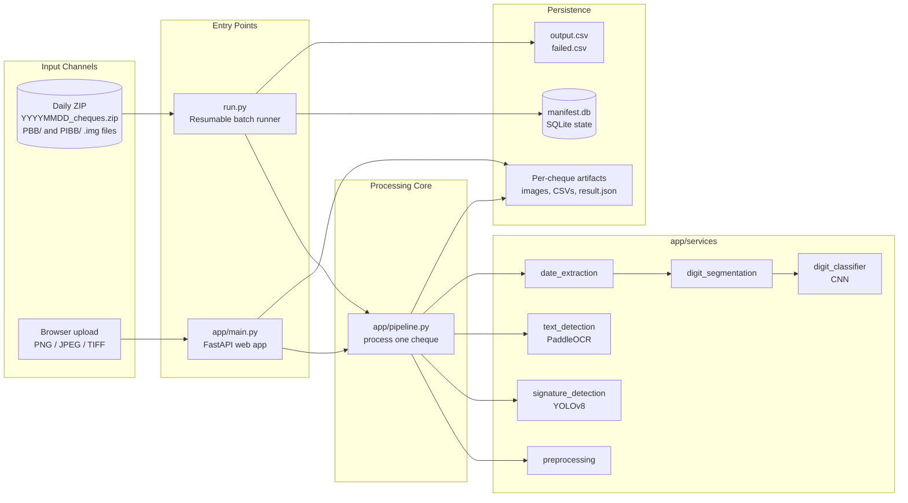
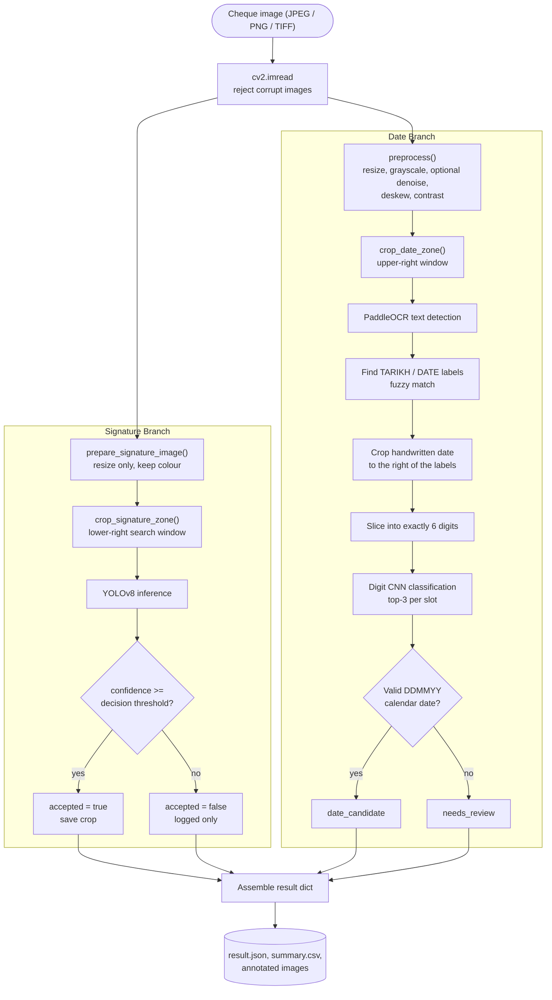
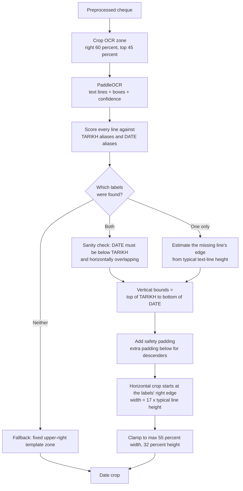
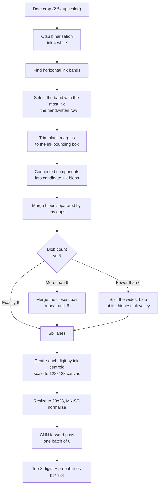
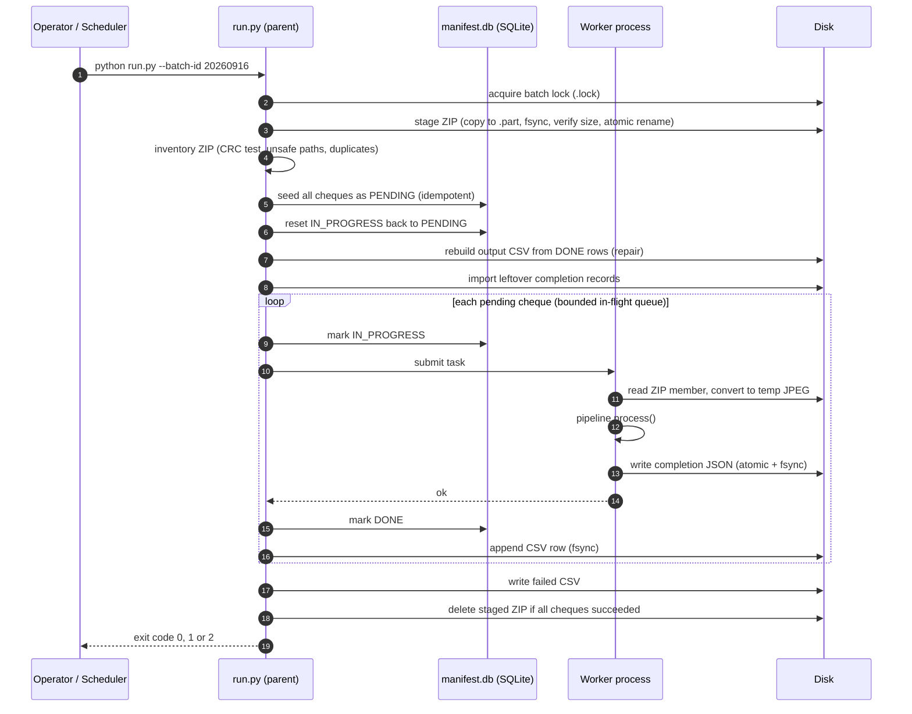
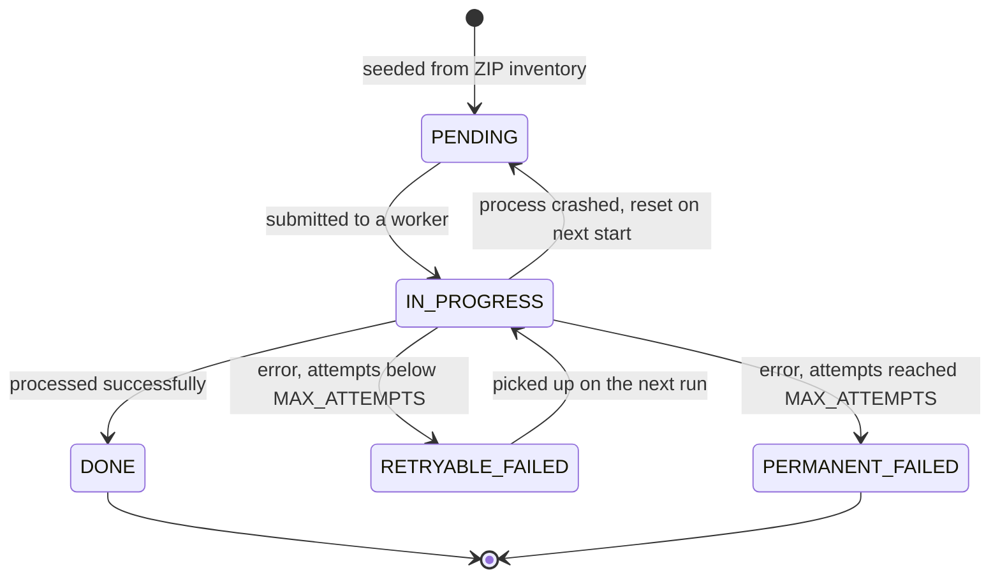
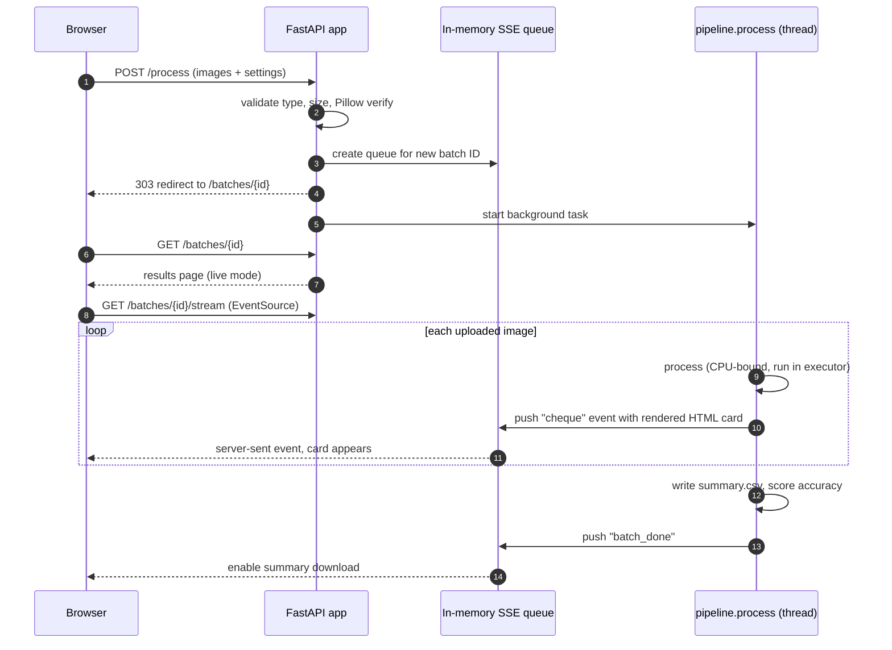
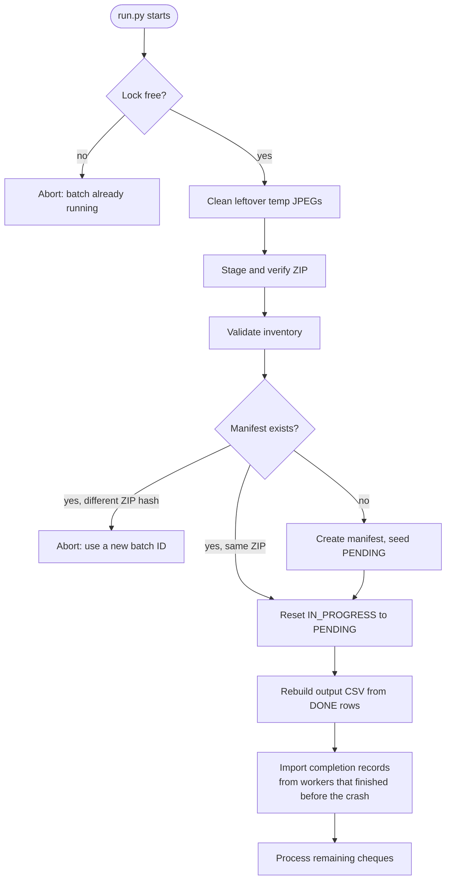

# Cheque Processing Platform

An auditable, crash-resilient cheque analysis pipeline built with **FastAPI**, **YOLOv8**, **PaddleOCR**, and a **digit-recognition CNN**. For every cheque image the system answers two questions: *is there a signature?* and *what handwritten date is written on it?* It ships with two ways to run: a **web UI** for interactive review, and a **resumable ZIP batch runner** for high-volume daily processing (~20,000 cheques per batch), backed by a SQLite manifest so that no cheque is ever lost or processed twice, even after a crash.

---

## 📑 Table of Contents

- [Overview & Architecture](#-overview--architecture)
- [Key Features](#-key-features)
- [Extracted Entities](#-extracted-entities)
- [How a Single Cheque Is Processed](#-how-a-single-cheque-is-processed)
- [Batch Mode: Resumable ZIP Processing](#-batch-mode-resumable-zip-processing)
- [Web Mode: Live Review UI](#-web-mode-live-review-ui)
- [System Requirements](#-system-requirements)
- [Installation & Setup](#-installation--setup)
- [Configuration (.env)](#-configuration-env)
- [Running the Application](#-running-the-application)
- [Web Routes Reference](#-web-routes-reference)
- [Output Reference](#-output-reference)
- [Accuracy Scoring](#-accuracy-scoring)
- [Directory Structure & Storage Layout](#-directory-structure--storage-layout)
- [Performance & Worker Tuning](#-performance--worker-tuning)
- [Failure Handling & Resiliency](#-failure-handling--resiliency)
- [Security Notes](#-security-notes)
- [Known Limitations](#-known-limitations)
- [Troubleshooting](#-troubleshooting)

---

## 🏗 Overview & Architecture

The project has **one processing core** (`app/pipeline.py`) and **two front doors** that feed it. Both entry points call the same `process()` function, so a cheque produces identical results whether it came from the browser or from the nightly ZIP.



### Two modes at a glance

| | **Batch mode** (`run.py`) | **Web mode** (`app/main.py`) |
| :--- | :--- | :--- |
| **Purpose** | Production volume, unattended, daily | Interactive review, tuning, demos |
| **Input** | `YYYYMMDD_cheques.zip` of `.img` files | PNG / JPEG / TIFF uploads (multi-file) |
| **Concurrency** | Multi-process worker pool | One cheque at a time in a background task |
| **State** | SQLite manifest (durable, resumable) | In-memory event queue (live view only) |
| **Output** | `<batch>_output.csv` + `<batch>_failed.csv` | Live result cards + `summary.csv` |
| **Accuracy scoring** | No | Yes (against `ground_truth.csv`) |

---

## ✨ Key Features

- **Two-signal analysis per cheque**: YOLOv8 signature detection and OCR-anchored handwritten-date reading, each independently reported with confidence scores.
- **Layout-anchored date reading**: instead of trusting a fixed pixel position, the system uses PaddleOCR to find the printed **TARIKH / DATE** labels and crops the handwritten date relative to them. This makes it robust to different scan sizes and small template shifts.
- **Fuzzy label matching**: tolerates common OCR misreads (`TARlKH`, `D4TE`, `DATF`, …) and can reconstruct the crop from a single found label when the other is unreadable.
- **Ink-driven digit segmentation**: connected-component clustering splits the date row into exactly six digits, merging broken strokes and splitting touching digits at their thinnest ink point.
- **Calendar validation**: the six digits (`DDMMYY`) are checked against the real calendar (including leap years) and flagged `date_candidate` or `needs_review`.
- **Resumable batch processing**: a SQLite manifest tracks every cheque's state. Kill the process at any moment and a re-run resumes exactly where it stopped.
- **Durable, exactly-once output**: a per-cheque completion record is written and fsynced *before* the parent acknowledges it, and the output CSV is rebuilt on startup to repair any half-written row.
- **Safe ZIP ingestion**: CRC validation, path-traversal rejection, duplicate detection, atomic staging copy, and streaming reads (the ZIP is never bulk-extracted to disk).
- **Auto-sized worker pool**: worker count derived from CPU cores, with native thread pools (OpenMP / MKL / BLAS) capped per worker to prevent oversubscription.
- **Live web UI**: Server-Sent Events stream each cheque's result card to the browser the moment it finishes.
- **Built-in accuracy report**: compare results against a ground-truth CSV and get per-cheque and aggregate signature / digit accuracy.
- **Full audit trail**: annotated images, crops, per-digit top-3 candidates, and a complete `result.json` for every cheque (optional, toggled by `SAVE_ARTIFACTS`).

---

## 🎯 Extracted Entities

| Field | Description |
| :--- | :--- |
| `signature_detected` | `YES` / `NO`. Whether at least one YOLO detection met the decision threshold. |
| Signature detections | Bounding boxes (`x1, y1, x2, y2`) and confidence for up to 2 candidates. |
| `date` | Handwritten date formatted as `DD/MM/YY`. |
| `date_status` | `date_candidate` (valid calendar date), `needs_review` (best guess, invalid or uncertain), or `empty_crop`. |
| `raw_digits` | The six classified digits with no separators, e.g. `160926`. |
| `date_confidence` | The **weakest** per-digit probability (a date is only as trustworthy as its least certain digit). |
| Per-digit top-3 | For each of the 6 slots, the three most likely digits with probabilities. |
| OCR text lines | All printed text found in the date region with quadrilateral coordinates and confidence. |
| `bank_code` (batch) | `PBB` or `PIBB`, taken from the ZIP folder the cheque lives in. |

> **Signature detection is presence detection only.** The system reports *whether a signature-like region exists*, not whether it is *authentic* or matches a specimen.

> **Review-assisted by design.** Handwriting varies. Treat `needs_review` results as prompts for a human check, and use the confidence values to prioritise that review.

---

## 🔬 How a Single Cheque Is Processed

`process()` in `app/pipeline.py` runs these stages. The signature branch and the date branch are independent of each other (they share only the input image).



### Stage 1: Preprocessing (`app/services/preprocessing.py`)

The pipeline deliberately produces **two different copies** of the image, because signature detection and OCR want opposite things:

| Copy | Steps | Why |
| :--- | :--- | :--- |
| **OCR copy** (`preprocess`) | Upscale small scans (short edge below 1000 px, up to 4×) → cap the long edge (`PREPROCESS_MAX_LONG_EDGE`, default 3000) → grayscale → optional denoise → deskew (only if the angle is within ±8°, otherwise ignored as unreliable) → contrast boost | Clean, high-contrast text is easier for OCR and digit slicing. |
| **Signature copy** (`prepare_signature_image`) | Resize only, **colour preserved**, long edge capped at `SIGNATURE_MAX_LONG_EDGE` (1600) | Denoise / contrast / deskew can erase light pen strokes, so YOLO gets an untouched colour copy. |

The original image is never modified.

### Stage 2: Signature detection (`app/services/signature_detection.py`)

1. The resized colour image is cropped to a **search zone** (default: right 70% of the width, from 55% to 92% of the height), where signatures reliably sit on this cheque template. A smaller search area means real signature ink occupies far more of the model's input pixels and is not drowned out by security-pattern background.
2. **YOLOv8** runs on the crop (`SIGNATURE_IMGSZ`, default 640; NMS IoU 0.70; at most 2 detections).
3. Every candidate above a very low *logging floor* (1%) is recorded so you can inspect near-misses, but only candidates at or above the **decision threshold** (default `0.30`) are marked `accepted`.
4. Box coordinates are translated back into the full-image frame using the crop offset, so annotations always land correctly on the full cheque.
5. The cheque counts as `signature_detected = YES` if **any** candidate is accepted.

The model is loaded once per process behind a lock. If the weights file is missing, the code can optionally download it from Hugging Face (`HF_YOLO_REPO_ID` + `HF_YOLO_FILENAME`).

### Stage 3: Locating the date field (`app/services/text_detection.py`, `date_extraction.py`)

Cheque dates are handwritten, but the **printed labels beside them** are stable. On a Public Bank cheque, `TARIKH` sits directly above `DATE`. The system finds those labels first, then reads what is to their right.



Key ideas worth knowing:

- **Fuzzy matching.** Each OCR line is normalised (uppercase, alphanumerics only) and scored against alias lists using substring match plus `difflib` similarity (threshold 0.66). Aliases include known OCR corruptions such as `TARlKH`, `D4TE`, `DATF`. A weak `WN` token is accepted as a possible label only in the upper-right region.
- **Scale-invariant sizing.** Crop padding and width are expressed in multiples of the **median text-line height** found on the page, not in pixels, so the geometry holds when scan resolution changes.
- **Asymmetric padding.** Extra room is added *below* the labels because looped digits (a `6` or `2`) and descenders extend lower than printed text predicts.
- **Hard ceilings.** Crop size is capped as a fraction of the page as a last line of defence against a bad anchor measurement.

### Stage 4: Reading the digits (`digit_segmentation.py`, `digit_classifier.py`)

The date crop is upscaled 2.5×, then converted into exactly six normalised digit images.



Why this design:

- **Band selection by ink area** (not height) rejects the small printed `D D M M Y Y` guide letters and stray text above the date.
- **Cluster to exactly six** handles the two classic handwriting failure modes: a digit drawn in two strokes (merge) and two digits that touch, such as a connected `26` (split at the valley).
- **Centroid centring** narrows the domain gap between real cheque ink and the MNIST-style data the classifier was trained on.
- **One batched forward pass** for all six digits is much cheaper than six separate calls.

The classifier backend is swappable via `DIGIT_MODEL_BACKEND`:

| Backend | Model | Notes |
| :--- | :--- | :--- |
| `torch_pickle` *(default)* | Small CNN (`DigitCNN`, from `developerPratik/mnist-cnn-classifier`) | Built for 28×28 digits, fast on CPU. |
| `transformers` | ViT-based MNIST model | ~17.5 GFLOPs per digit (≈105 GFLOPs per cheque), so it dominated the date stage; kept as an option only. |

### Stage 5: Validation and result

The six winning digits are formatted as `DD/MM/YY` and validated as a real calendar date (`2000 + YY`, leap-year aware). Overall `confidence` is the **minimum** per-digit probability. The final dictionary is written atomically to `result.json` (temp file + `os.replace`).

---

## 📦 Batch Mode: Resumable ZIP Processing

Batch mode is built for one job: take the day's ZIP, process every cheque in it, and produce one CSV, *reliably*, even if the machine dies halfway.

### Input contract

- File name: `YYYYMMDD_cheques.zip` (pattern configurable via `BATCH_ZIP_NAME_PATTERN`), placed in `data/incoming/`.
- Contents: `.img` files beneath a top-level `PBB/` and/or `PIBB/` folder. Non-`.img` files are ignored; an `.img` outside those folders is rejected.
- Each `.img` is decoded with Pillow, **frame zero** is used (multi-frame TIFF-style images), converted to RGB if needed, and re-encoded as a temporary JPEG (quality 95) that is deleted immediately after processing. Nothing is bulk-extracted to disk.

### End-to-end flow



### Cheque lifecycle

Every cheque is a row in the manifest's `cheques` table and moves through this state machine:



> Each run attempts every unfinished cheque **once**. A cheque that fails becomes `RETRYABLE_FAILED` and is retried the **next time `run.py` is executed**, up to `MAX_ATTEMPTS` total attempts (default 3). Wire the runner to a scheduler and use its exit code to trigger a re-run (see below).

### Why it never loses or duplicates a cheque

| Concern | Mechanism |
| :--- | :--- |
| Corrupt or hostile ZIP | `testzip()` CRC check, `..` / absolute-path rejection, duplicate-member rejection, folder-prefix enforcement |
| Half-copied ZIP | Copy to `*.part`, `fsync`, compare size to source, then atomic `os.replace` |
| Original ZIP safety | The source ZIP is **never modified**; only the staged copy is deleted after a fully successful batch |
| Wrong ZIP for a batch ID | Manifest stores the ZIP's **SHA-256 fingerprint**; a different ZIP with the same batch ID is refused |
| Changed inventory | If the ZIP's cheque list differs from the manifest, resume is refused rather than risk wrong results |
| Two runners at once | Exclusive file lock (`.lock`) per batch directory |
| Crash mid-cheque | `IN_PROGRESS` rows are reset to `PENDING` on next start and reprocessed |
| Crash between "worker finished" and "parent recorded it" | The worker writes an fsynced **completion JSON** first; on restart the runner imports any leftover completion records |
| Ambiguous last CSV row after a crash | The output CSV is **rebuilt atomically** from `DONE` rows on every start, before new rows are appended |
| Duplicate CSV rows | An `output_emitted` flag per cheque makes appends idempotent |
| One bad scan killing the batch | Each worker catches its own exceptions; failure is recorded and the batch continues |
| Memory blow-up on 20,000 cheques | Only `workers × BATCH_INFLIGHT_MULTIPLIER` tasks are ever queued at once |

### Exit codes

| Code | Meaning |
| :--- | :--- |
| `0` | Every cheque is `DONE`. |
| `1` | Some cheques are still unfinished (`PENDING` / `RETRYABLE_FAILED`). Re-run to continue. |
| `2` | Everything was attempted, but some cheques are `PERMANENT_FAILED`. See `<batch>_failed.csv`. |

---

## 🖥 Web Mode: Live Review UI

The web app accepts one or many cheque images, processes them in the background, and streams each result to the browser as soon as it is ready. Upload and results are separate pages, so a finished batch has its own permanent URL.



**Design notes**

- Processing is CPU-bound (OpenCV, Paddle, YOLO, torch), so it runs via `run_in_executor`. This keeps the event loop free to flush SSE events immediately.
- One failing image emits a `cheque_error` event and the rest of the batch continues.
- While a batch is processing it lives in memory (`_batch_queues`). Once finished, the page is rebuilt purely from the saved `result.json` files, so **results survive a server restart**.
- Upload temp files are always deleted in a `finally` block.
- The upload form exposes preprocessing options (max edge, contrast, denoise, deskew), the signature threshold, and date search width, all bounds-checked on the server.

> **Requirement:** the web UI reads annotated images and `result.json` from disk, so it needs `SAVE_ARTIFACTS=true` (the default).

---

## ⚙️ System Requirements

- **Operating System**: **Windows** for batch mode (see [Known Limitations](#-known-limitations)). The web app itself is standard Python/FastAPI.
- **Python**: 3.10 or 3.11 (PaddleOCR support is substantially better than on 3.9).
- **Hardware**: CPU-only inference. No GPU is required or used.
- **Disk**: allow for artifact output. With `SAVE_ARTIFACTS=true`, each cheque writes roughly 20 files.
- **Model files** (not included in the repository):
  - YOLOv8 signature weights, `models/yolov8s.pt`
  - Digit CNN weights, `models/developerPratik-mnist-cnn/best_model.pth`
  - PaddleOCR models (detection, recognition, optional angle classifier) in a shared folder

---

## 🚀 Installation & Setup

### 1. Clone the Repository
```powershell
git clone https://github.com/heyitssyakirrr/cheque-processing-platform.git
cd cheque-processing-platform
```

### 2. Create and Activate a Virtual Environment
```powershell
py -3.11 -m venv .venv
.\.venv\Scripts\Activate.ps1
```

### 3. Install Dependencies
```powershell
python -m pip install --upgrade pip
pip install -r requirements.txt
```

Key pinned versions: `paddlepaddle==2.6.2`, `paddleocr==2.10.0`, `numpy<2`.

### 4. Place the Model Files

```text
cheque-processing-platform/
└── models/
    ├── yolov8s.pt                          # signature detector (YOLO_MODEL_PATH)
    └── developerPratik-mnist-cnn/
        └── best_model.pth                  # digit classifier (DIGIT_MODEL_PATH)

../FileReader/models/                       # shared PaddleOCR models (OCR_MODELS_DIR)
├── en_PP-OCRv3_det_infer/
├── en_PP-OCRv3_rec_infer/
└── ch_ppocr_mobile_v2.0_cls_infer/         # optional angle classifier
```

- The PaddleOCR models are read from a **shared folder** (default `../FileReader/models`) so several projects can use one copy instead of duplicating them. Point `OCR_MODELS_DIR` elsewhere if your layout differs.
- If the YOLO file is missing you may instead set `HF_YOLO_REPO_ID` and `HF_YOLO_FILENAME`; the weights are downloaded once and cached under `models/`.
- On an **offline** machine, make sure all three model sets are already on disk; PaddleOCR will otherwise try (and fail) to download.

### 5. Create the `.env`
See the next section. Every setting has a default, so a minimal `.env` is enough.

---

## 🔧 Configuration (.env)

Settings are defined in one validated object (`app/settings.py`, Pydantic Settings). Every field can be overridden by an environment variable of the **same name (case-insensitive)** or by a line in `.env` at the project root.

### Minimal example

```ini
# Model locations
YOLO_MODEL_PATH=models/yolov8s.pt
DIGIT_MODEL_PATH=models/developerPratik-mnist-cnn/best_model.pth
OCR_MODELS_DIR=../FileReader/models

# Behaviour
SAVE_ARTIFACTS=true
WORKER_COUNT=1
```

### Signature detection

| Variable | Default | Description |
| :--- | :--- | :--- |
| `YOLO_MODEL_PATH` | `models/yolov8s.pt` | Weights path, relative to project root. |
| `HF_YOLO_REPO_ID` / `HF_YOLO_FILENAME` | *(empty)* | Optional Hugging Face source used only if the local file is missing. |
| `SIGNATURE_IMGSZ` | `640` | YOLO inference resolution. Source scans are small (~700×350), so higher values add compute without adding information. |
| `SIGNATURE_IOU` | `0.70` | NMS overlap threshold between candidate boxes. |
| `SIGNATURE_DECISION_THRESHOLD` | `0.30` | Confidence at or above which a box counts as "signature present". |
| `SIGNATURE_LOGGING_FLOOR` | `0.01` | Lowest confidence still recorded for inspection. |
| `SIGNATURE_MAX_LONG_EDGE` | `1600` | Resize ceiling for the signature copy of the image. |
| `SIGNATURE_ZONE_LEFT_FRACTION` | `0.30` | Left edge of the search window (fraction of width). |
| `SIGNATURE_ZONE_TOP_FRACTION` | `0.55` | Top edge of the search window (fraction of height). |
| `SIGNATURE_ZONE_BOTTOM_FRACTION` | `0.92` | Bottom edge of the search window (fraction of height). |

### Date field location (OCR)

| Variable | Default | Description |
| :--- | :--- | :--- |
| `OCR_MODELS_DIR` | `../FileReader/models` | Folder holding the PaddleOCR model sub-folders. |
| `OCR_ZONE_LEFT_FRACTION` | `0.40` | Left edge of the region OCR scans for labels. |
| `OCR_ZONE_TOP_FRACTION` / `OCR_ZONE_BOTTOM_FRACTION` | `0.00` / `0.45` | Vertical extent of the OCR region. |
| `DATE_LABEL_LINE_GAP_RATIO` | `0.2` | Gap used when estimating a missing label line. |
| `DATE_FIELD_VERTICAL_SAFETY_PAD_RATIO` | `0.15` | Padding above and below the label span. |
| `DATE_FIELD_BOTTOM_EXTRA_PAD_RATIO` | `0.35` | Extra padding below, for descenders and loops. |
| `DATE_FIELD_WIDTH_TYPICAL_HEIGHTS` | `17.0` | Crop width in multiples of typical line height. |
| `DATE_FIELD_MAX_WIDTH_FRACTION` / `DATE_FIELD_MAX_HEIGHT_FRACTION` | `0.55` / `0.32` | Hard ceiling on crop size. |
| `DATE_USE_TEMPLATE_ZONE` | `false` | Debug only: skip OCR and use the fixed template zone. Keep **off** in production. |

### Digit classifier

| Variable | Default | Description |
| :--- | :--- | :--- |
| `DIGIT_MODEL_BACKEND` | `torch_pickle` | `torch_pickle` (small CNN) or `transformers` (ViT). |
| `DIGIT_MODEL_PATH` | `models/developerPratik-mnist-cnn/best_model.pth` | Weights matching the chosen backend. Change both together. |
| `DIGIT_COUNT` | `6` | Expected digits per date (`DDMMYY`). |
| `DIGIT_INK_THRESHOLD` | `140` | Fixed grayscale cut-off for "ink". |

### Preprocessing

| Variable | Default | Description |
| :--- | :--- | :--- |
| `PREPROCESS_MAX_LONG_EDGE` | `3000` | Long-edge cap for the OCR copy. |
| `PREPROCESS_CONTRAST` | `1.15` | Contrast multiplier. |
| `PREPROCESS_DESKEW` | `true` | Correct small tilt (up to 8°). |
| `PREPROCESS_DENOISE` | `false` | Non-local-means denoise. Costs about a second per cheque, so it is off by default. |

### Batch ingestion

| Variable | Default | Description |
| :--- | :--- | :--- |
| `INCOMING_TRANSPORT` | `local` | Only `local` is implemented. Any other value fails validation at startup. |
| `INCOMING_ROOT` | `data/incoming` | Folder searched for the daily ZIP. |
| `BATCH_ZIP_NAME_PATTERN` | `{date}_cheques.zip` | Expected ZIP name for a batch ID. |
| `STAGING_DIR_NAME` | `data/staging` | Where the ZIP copy is staged. |
| `MAX_ATTEMPTS` | `3` | Total attempts per cheque before it is permanently failed. |
| `CLEANUP_ZIP_AFTER_BATCH` | `true` | Delete the staged copy after a fully successful batch. |
| `BATCH_INFLIGHT_MULTIPLIER` | `2` | Queued futures per worker. |
| `GROUND_TRUTH_PATH` | `data/ground_truth.csv` | Ground-truth file for accuracy scoring. |
| `SAVE_ARTIFACTS` | `true` | Write per-cheque debug files. Turn **off** for production volume. |
| `MAX_UPLOAD_MB` | `15` | Maximum single upload size in the web app. |

### Worker sizing

| Variable | Default | Description |
| :--- | :--- | :--- |
| `WORKER_COUNT` | `0` | Fixed worker count. `0` means auto-size. |
| `WORKER_UTILIZATION_TARGET` | `0.40` | Fraction of usable cores to use when auto-sizing (0.05 to 1.0). |
| `RESERVED_LOGICAL_CORES` | `8` | Cores left free for the OS and other processes. |
| `MAX_WORKER_CAP` | `0` | Optional hard ceiling (`0` = none). |
| `THREADS_PER_WORKER` | `1` | Native threads per worker (OpenMP / MKL / BLAS / OpenCV / torch / Paddle). |

---

## 🏃 Running the Application

### Web UI

```powershell
uvicorn app.main:app --host 127.0.0.1 --port 8000
```

Open `http://127.0.0.1:8000`. For development with hot-reload you can also run `python -m app.main`, which listens on port `5000`.

> Run a **single** Uvicorn worker (the default). Batch progress lives in an in-memory queue, so multiple web workers would not share it.

The first request loads the models, so it is slower than the ones after it.

### Batch runner

1. Copy the day's ZIP into `data/incoming/`, named `YYYYMMDD_cheques.zip`.
2. Run:

```powershell
python run.py --batch-id 20260916
```

`--batch-id` must be 8 digits (`YYYYMMDD`) and defaults to today's date.

Example console output:

```text
Batch 20260916: 20000 cheques; 20000 to process; 12 worker(s).
[1/20000] PBB/000001.img -> DONE
[2/20000] PIBB/000002.img -> DONE
...
Output: data\batches\20260916\20260916_output.csv
Status: {'DONE': 19997, 'PERMANENT_FAILED': 3}
```

**To resume after a crash, power loss, or Ctrl+C: run the exact same command again.** Finished cheques are skipped, interrupted ones restart, and the CSV is repaired first.

### Scheduling a daily run (Windows Task Scheduler)

```powershell
schtasks /Create /SC DAILY /ST 02:00 /TN "ChequeBatch" `
  /TR "cmd /c cd /d C:\path\to\cheque-processing-platform && .venv\Scripts\python.exe run.py"
```

Because the batch ID defaults to today's date, no arguments are needed. Have the scheduler (or a wrapper script) re-run the command when the exit code is `1`, and alert someone when it is `2`.

### Start with one worker

Begin with `WORKER_COUNT=1` on a laptop and increase only after measuring memory and throughput on the target machine. With one worker the runner processes in-process (no process pool), which is also the easiest mode to debug.

---

## 📡 Web Routes Reference

| Method | Path | Purpose |
| :--- | :--- | :--- |
| `GET` | `/` | Upload page with adjustable processing settings. |
| `POST` | `/process` | Accept images, start background processing, `303` redirect to the batch page. |
| `GET` | `/batches/{batch_id}` | Results page. Live (SSE) while running; rebuilt from disk once finished. |
| `GET` | `/batches/{batch_id}/stream` | Server-Sent Events stream (only while the batch is processing). |
| `GET` | `/batches/{batch_id}/summary.csv` | Download the batch summary CSV. |
| `GET` | `/batches/{batch_id}/accuracy_report.csv` | Download the accuracy report CSV. |
| `POST` | `/batches/{batch_id}/ground-truth` | Re-score a finished batch after editing `ground_truth.csv`. |
| `GET` | `/batches/{batch_id}/{run_id}/{artifact}` | Serve one image or file from a single cheque's own folder. |

### `POST /process`

`multipart/form-data`:

| Field | Type | Allowed range | Default |
| :--- | :--- | :--- | :--- |
| `cheques` | file(s) | PNG, JPEG, TIFF; up to `MAX_UPLOAD_MB` each | required |
| `max_edge` | int | 800 to 5000 | 2200 |
| `contrast` | float | 0.5 to 2.5 | 1.15 |
| `yolo_threshold` | float | 0.1 to 0.95 | 0.50 (form pre-fills 0.30) |
| `date_width` | int | 100 to 1000 | 450 (accepted for compatibility; not used by the current date crop) |
| `denoise` | bool | | false |
| `deskew` | bool | | false |

Example:

```bash
curl -X POST "http://127.0.0.1:8000/process" \
     -F "cheques=@cheque1.jpg" -F "cheques=@cheque2.jpg" \
     -F "yolo_threshold=0.30" -i
```

| Status | Meaning |
| :--- | :--- |
| `303` | Accepted. `Location` points to `/batches/{batch_id}`. |
| `413` | A file exceeds the size limit. |
| `415` | Content type is not PNG, JPEG, or TIFF. |
| `422` | No file selected, file is not a valid image, or a setting is out of range. |
| `404` | Unknown or malformed batch / run ID, or artifact outside the run folder. |

### Server-Sent Events

| Event | Payload |
| :--- | :--- |
| `batch_start` | `{ batch_id, total }` |
| `cheque` | `{ html, signature_detected, date_status }`, where `html` is the rendered result card |
| `cheque_error` | `{ filename, sequence, error }` |
| `batch_done` | `{ batch_id, completed, summary_url }` |

---

## 📊 Output Reference

### Batch output CSV: `data/batches/<batch_id>/<batch_id>_output.csv`

One row per successfully processed cheque, appended live and fsynced.

| Column | Description |
| :--- | :--- |
| `batch_id` | The batch (`YYYYMMDD`). |
| `cheque_id` | Unique ID, the ZIP member path (e.g. `PBB/000001.img`). |
| `bank_code` | `PBB` or `PIBB`. |
| `sequence` | 1-based order within the sorted ZIP inventory. |
| `filename` | The `.img` file name. |
| `signature_detected` | `YES` / `NO`. |
| `date` | Handwritten date, `DD/MM/YY`. |
| `start_time`, `end_time` | Wall-clock processing window for this cheque. |
| `duration_seconds` | Total processing time. |
| `pixels` | Original image size, `WIDTHxHEIGHT`. |
| `t_read`, `t_preprocess`, `t_signature`, `t_ocr`, `t_date` | Per-stage timings in seconds, for spotting bottlenecks. |
| `error` | Empty on success. |

### Batch failure CSV: `<batch_id>_failed.csv`

Columns: `batch_id, cheque_id, bank_code, sequence, attempts, last_error`. Lists only cheques that exhausted `MAX_ATTEMPTS`.

### Web summary CSV: `summary.csv`

`sequence, filename, run_id, signature_detected, signature_confidence, date, date_status, date_confidence, raw_digits, date_validation, text_region_count, preprocessing_scale, preprocessing_deskew_degrees`

### `result.json` (per cheque, abridged and illustrative)

```json
{
  "run_id": "001-cheque-0001",
  "batch_id": "20260916",
  "sequence": 1,
  "source_filename": "000001.img",
  "pixels": "700x350",
  "timings": { "read": 0.01, "preprocess": 0.12, "signature": 0.35, "ocr": 0.80, "date": 0.09 },
  "preprocessing": { "scale": 4.0, "deskew_degrees": -0.4, "signature_scale": 2.86 },
  "signature": {
    "exists": true,
    "detections": [
      { "id": 1, "confidence": 0.8123, "accepted": true, "x1": 812, "y1": 655, "x2": 1390, "y2": 830 }
    ]
  },
  "text": { "count": 14, "detections": [ { "id": 1, "text": "TARIKH", "confidence": 0.97, "box": [[...]] } ] },
  "date": {
    "status": "date_candidate",
    "date": "16/09/26",
    "raw_digits": "160926",
    "confidence": 0.9421,
    "anchor_text": "TARIKH / DATE",
    "crop_box": [1710, 120, 2480, 420],
    "label_bounds_estimated": false,
    "digit_top3": [[["1", 0.99], ["7", 0.004], ["4", 0.002]], "..."]
  }
}
```

### Per-cheque artifact folder (when `SAVE_ARTIFACTS=true`)

```text
data/batches/<batch_id>/<seq>-<name>/
├── original/cheque.png
├── preprocessed/cheque.png
├── signature/
│   ├── annotated.png          # boxes + the orange "search zone" rectangle
│   ├── crops/signature_N.png  # accepted detections only
│   └── detections.csv
├── text/
│   ├── annotated.png          # every OCR box with its text and confidence
│   └── detections.csv
├── date/
│   ├── crop.png               # exactly what the digit classifier saw
│   ├── digits/digit_0..5.png  # the six normalised digit images
│   ├── digit_confidence.csv   # top-3 candidates per slot
│   └── result.csv
├── result.json                # complete machine-readable record
└── summary.csv                # one-row summary
```

The orange **search zone** rectangle on `signature/annotated.png` is intentionally always drawn, so you can check whether the zone fractions in your settings actually cover where signatures sit.

---

## 🎯 Accuracy Scoring

The web app can score a batch against known-correct answers. Create `data/ground_truth.csv`:

```csv
filename,signature_count,date
000001.img,1,160926
000002.img,2,050826
000003.img,0,no date
```

- `filename` is matched by **lowercased stem**, so the extension does not need to match.
- `date` is `DDMMYY` (separators are ignored) or `no date`.
- Scoring runs automatically when a web batch finishes. After editing the CSV, use **Rescore** on the results page to re-score without reprocessing images.

| Metric | Meaning |
| :--- | :--- |
| Signature detection rate | Total predicted signatures ÷ total ground-truth signatures |
| Cheques with a signature found | Of cheques that truly have a signature, how many got at least one detection (the forgiving question) |
| Digit accuracy | Correct digits ÷ total digits, compared position by position |
| Exact date match | Cheques where all six digits are correct |

Results are saved as `accuracy_report.json` and `accuracy_report.csv` in the batch folder.

---

## 📂 Directory Structure & Storage Layout

```text
├── app/
│   ├── main.py                       # FastAPI routes, upload validation, SSE, accuracy endpoints
│   ├── pipeline.py                   # process(): orchestrates one cheque end to end
│   ├── settings.py                   # Validated configuration (Pydantic Settings)
│   ├── ingestion.py                  # ZIP staging, inventory, SHA-256, batch lock
│   ├── manifest.py                   # SQLite state machine + output CSV writer
│   ├── services/
│   │   ├── preprocessing.py          # Resize / deskew / contrast; signature and OCR zone crops
│   │   ├── signature_detection.py    # YOLOv8 inference, annotation, crops
│   │   ├── text_detection.py         # PaddleOCR engine + annotated output
│   │   ├── date_extraction.py        # Label anchoring, crop geometry, calendar validation
│   │   ├── digit_segmentation.py     # Ink-based slicing into exactly 6 digit images
│   │   ├── digit_classifier.py       # Loads CNN/ViT, batched top-k prediction
│   │   ├── digit_model.py            # DigitCNN architecture definition
│   │   ├── img_conversion.py         # .img bytes to JPEG (frame zero)
│   │   ├── accuracy.py               # Ground-truth loading and scoring
│   │   └── field_extraction.py       # Payee / amount heuristics (not wired into the pipeline)
│   ├── templates/                    # index.html, results.html, _cheque_card.html
│   └── static/site.css               # Public Bank-inspired red UI theme
├── run.py                            # Resumable batch runner (CLI)
├── script.py                         # Standalone signature-detection test harness
├── requirements.txt
└── Runtime data (generated, git-ignored):
    ├── models/                       # YOLO + digit CNN weights
    └── data/
        ├── incoming/                 # Daily ZIPs are dropped here (also web upload temp files)
        ├── staging/                  # Verified copy of the ZIP being processed
        ├── ground_truth.csv          # Optional accuracy reference
        └── batches/<batch_id>/
            ├── manifest.db           # SQLite source of truth
            ├── .lock                 # Single-runner lock
            ├── completion/           # Durable per-cheque completion records
            ├── tmp/                  # Temporary JPEGs (auto-cleaned)
            ├── <batch_id>_output.csv
            ├── <batch_id>_failed.csv
            ├── summary.csv           # Web mode
            ├── accuracy_report.json / .csv
            └── <seq>-<name>/         # Per-cheque artifact folders
```

`script.py` is an independent, offline **YOLO signature test bench** with its own CLI flags (`--conf-threshold`, `--imgsz`, `--target-min-dim`, …). It reads from `Upload/` and writes to `Output/`, and is useful for tuning the signature model without running the full pipeline.

---

## 🚀 Performance & Worker Tuning

**Auto-sizing formula** (when `WORKER_COUNT=0`):

```text
usable  = max(1, logical_cores - RESERVED_LOGICAL_CORES)
workers = max(1, floor(usable × WORKER_UTILIZATION_TARGET))
workers = min(workers, MAX_WORKER_CAP)   # only if the cap is non-zero
workers = min(workers, number_of_cheques_to_process)
```

With the defaults (`0.40` utilisation, `8` reserved cores):

| Logical cores | Workers |
| :--- | :--- |
| 8 | 1 |
| 16 | 3 |
| 32 | 9 |
| 64 | 22 |
| 128 | 48 |

**Why `THREADS_PER_WORKER=1` matters.** Native libraries (OpenMP, MKL, BLAS, Paddle, torch) each start their own thread pool. Without a cap, 25 workers × 16 threads would fight over the same cores. `run.py` sets `OMP_NUM_THREADS` / `MKL_NUM_THREADS` / `OPENBLAS_NUM_THREADS` / `NUMEXPR_NUM_THREADS` *before* importing torch, then also limits OpenCV, torch, and Paddle inside each worker. Keep `workers × threads_per_worker` at or below the core count.

**Warm-up.** Every worker pre-loads the YOLO model, PaddleOCR engine, and digit CNN when it starts, so the first cheque is not penalised.

**Levers, roughly in order of impact:**

1. Set `SAVE_ARTIFACTS=false` for production. It removes about 20 file writes per cheque.
2. Leave `PREPROCESS_DENOISE=false` unless date accuracy demands it (about 1 s per cheque).
3. Keep `SIGNATURE_IMGSZ=640` unless you can demonstrate a benefit from more.
4. Use the `t_*` columns in the output CSV to see which stage dominates before tuning anything.

---

## 🛡 Failure Handling & Resiliency



- **Per-cheque isolation.** A corrupt image, an unreadable `.img`, or a model exception is caught per cheque. It is recorded in the manifest with its error text (truncated to 4000 characters) and the batch continues.
- **Worker crash safety.** If a worker process dies, the future's exception is captured and the cheque is marked failed rather than crashing the runner. Anything left `IN_PROGRESS` is reset on the next run.
- **Atomic writes everywhere.** `result.json`, completion records, and rebuilt CSVs are written to a temp file, fsynced, then swapped in with `os.replace`, so readers never see a partial file.
- **SQLite durability.** The manifest uses WAL journaling with `synchronous=FULL`.
- **Bounded retries.** Failures are retried across runs up to `MAX_ATTEMPTS`; after that they are parked in the failed CSV for a human instead of looping forever.
- **Safe cleanup.** The staged ZIP is deleted only when no cheque is pending and none has permanently failed.
- **Web mode isolation.** One failing image emits `cheque_error`; the queue always receives its end-of-stream sentinel via `finally`, so the browser is never left hanging.

---

## 🔒 Security Notes

- Uploads are restricted to PNG / JPEG / TIFF, size-limited while streaming, verified with Pillow, and saved under a random UUID name. Uploaded files are never executed.
- Batch and run IDs are validated with a strict pattern (`[A-Za-z0-9_-]{1,80}`), and artifact serving checks that the resolved path stays **inside** the requested run folder, preventing path traversal.
- ZIP members with absolute paths or `..` segments are rejected before any processing.
- The app has **no authentication**. Deploy behind authentication and TLS (for example a reverse proxy or the bank's SSO gateway) before exposing it beyond `localhost`, since cheque images and extracted data are sensitive.
- Artifacts contain full cheque images. Apply your organisation's retention policy to `data/batches/`, and restrict access to that folder.

---

## ⚠️ Known Limitations

- **Batch locking is Windows-only.** `ingestion.batch_lock` uses `msvcrt`, so `run.py` currently runs on Windows only. Linux support needs a `fcntl`-based lock.
- **SFTP is not implemented.** `INCOMING_TRANSPORT` accepts only `local`; the validator rejects anything else so the gap is never silent.
- **A date is always read as six digits.** The classifier is forced to output six slots, so a genuinely blank date field still yields a best-guess string. Rely on `date_status`, `date_confidence`, and calendar validation to catch these. There is not yet a dedicated "no date present" status.
- **Signature detection is presence-only**, not verification against a specimen.
- **Template-specific tuning.** Search zones and the date-label logic are calibrated to the Public Bank cheque layout. Other layouts may need adjusted zone fractions and label aliases.
- **Payee and amount are not extracted.** `field_extraction.py` contains simple heuristics but is not part of the current pipeline.
- **Accuracy scoring is web-mode only.** Batch mode records results but does not compare them to ground truth.
- **Retries happen across runs**, not inside a single run (see [Cheque lifecycle](#cheque-lifecycle)).

---

## 🧰 Troubleshooting

| Symptom | Likely cause | Fix |
| :--- | :--- | :--- |
| `FileNotFoundError: YOLO model missing` | Weights not at `YOLO_MODEL_PATH` | Place the file, fix the path, or set `HF_YOLO_REPO_ID` + `HF_YOLO_FILENAME`. |
| PaddleOCR tries to download models / fails offline | OCR models not found in `OCR_MODELS_DIR` | Confirm `en_PP-OCRv3_det_infer` and `en_PP-OCRv3_rec_infer` exist under that folder. |
| `Batch ZIP not found` | ZIP name or location is wrong | Name it `YYYYMMDD_cheques.zip`, place it in `data/incoming/`, and match `--batch-id`. |
| `Batch is already running (lock: …)` | Another `run.py` owns the batch, or a previous one was killed abruptly | Wait for the other run; the lock is released when the process exits. |
| `ZIP contains no .img files under PBB/ or PIBB/` | Wrong folder layout | Put `.img` files under a top-level `PBB/` or `PIBB/` folder. |
| `Existing manifest belongs to a different ZIP` | Same batch ID reused with a different ZIP | Use a new `--batch-id`, or delete that batch folder to start over. |
| `ZIP inventory differs from the existing manifest` | The ZIP contents changed after the batch began | Use a new batch ID. Resuming would be unsafe. |
| Web result card shows an error mentioning `fields` (`UndefinedError`) | `_cheque_card.html` still references `result.fields.payee_candidate` / `amount_candidate`, which the pipeline no longer produces | Remove those two metric blocks from the template, or add a `fields` entry back into the result. Batch mode is unaffected. |
| Web page shows no images / results vanish | `SAVE_ARTIFACTS=false` | Set `SAVE_ARTIFACTS=true` for the web UI. |
| Dates frequently `needs_review` | Labels not found, or crop misaligned | Open the batch's `date/crop.png` and `text/annotated.png` to see what was found, then adjust the `DATE_*` and `OCR_ZONE_*` settings. |
| Signatures missed | Zone or threshold too tight | Check the orange search zone on `signature/annotated.png`; adjust `SIGNATURE_ZONE_*` or lower `SIGNATURE_DECISION_THRESHOLD`. |
| Machine sluggish during a batch | Too many workers or threads | Lower `WORKER_COUNT` or raise `RESERVED_LOGICAL_CORES`; keep `THREADS_PER_WORKER=1`. |
